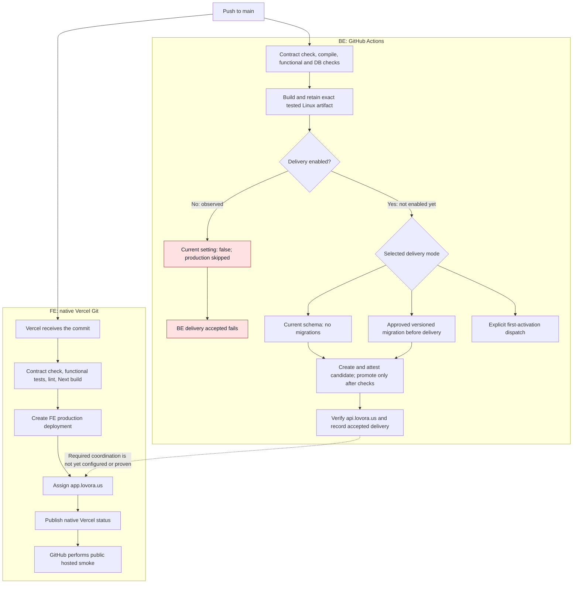
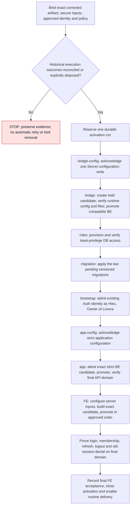
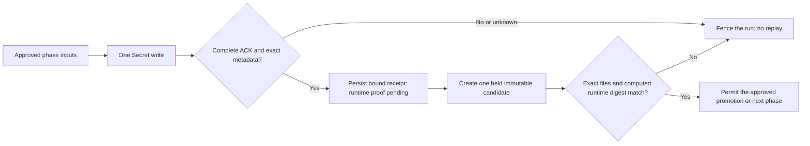
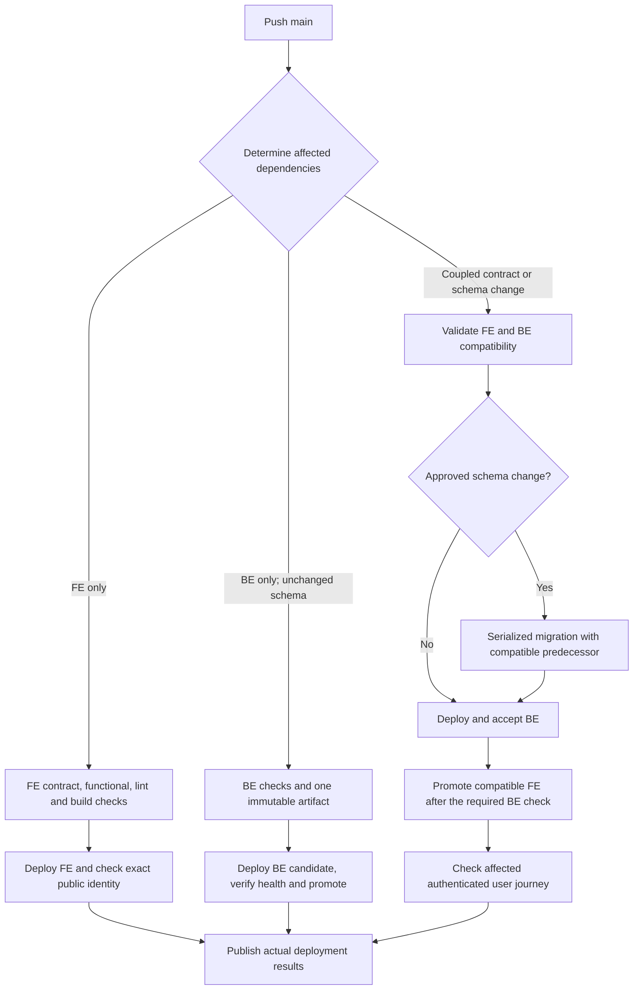

# FE and BE Deployment Flow

An evidence-based map of the current delivery system, its first-production blockers, and the intended routine deployment flow.

**Snapshot:** published source `f162c8db8ec149724c0a25537a4a0674bd012035`. This document is an explanatory snapshot, not a live deployment dashboard or a new implementation plan. Feature001 [plan](../specs/001-connectivity-foundation/plan.md), [tasks](../specs/001-connectivity-foundation/tasks.md), and [activation handoff](../specs/001-connectivity-foundation/production-activation-handoff.md) remain authoritative. No deployment, migration, lock clearance, or secret access is authorized by this document.

## 1. What is actually complete?

| Area | Observed state | What it does not establish |
| --- | --- | --- |
| FE missing-generator fix | Published in `b3b8710`; native Vercel build succeeded with 83 functional tests | A working authenticated Owner journey |
| BE Secret configuration fix | Published in `f162c8d`; 57 affected synthetic tests, one startup-digest test and a synthetic executable smoke passed; one scoped Luna review reported no actionable findings | A real Secret write, production migration, or deployment of the corrected BE |
| Current BE CI | `BE required checks` succeeded for `f162c8d` | A successful production delivery |
| Current BE delivery | `BE_DELIVERY_ENABLED=false`; production job skipped; `BE delivery accepted` failed | A product test regression is not demonstrated by this completion-check failure |
| Current FE evidence | Public hosted smoke succeeded for `f162c8d` | Login, refresh, logout, current membership, or database integration |
| GitHub preparation | Personal admin access verified; `be-production` restricted to `main`; three routine secret names present; mode/schema variables configured | Valid secret values or a complete first-activation input packet |
| Application database | Last read-only preflight found only the foundation migration; application schema, roles and session function were absent | Later production changes must be established by new receipts |
| Owner identity | Existing Auth identity was created and verified previously; display name Hieu and workspace Lovora approved | An active application Owner membership |

### CI evidence: do not keep waiting on an old observation

The BE worker's earlier receipt captured run `42404748672` while it was still building. A later direct query established:

- `BE required checks`: **success**.
- `BE production delivery`: **skipped**.
- `BE delivery accepted`: **failure**, correctly reflecting absent delivery.
- Artifact `13587251015`, named `be-tested-42404748672-1`, is available and not expired at inspection.
- GitHub artifact digest: `sha256:adf6b726971c34a2086a0d915f09ae91c595fdf6b1e92f95b5c5a939f99f67d2`.

Artifact availability is now established. Downloading, verifying and binding its exact inner BE artifact is a separate step; the GitHub artifact digest above must not be substituted for the application's sealed artifact digest.

Evidence: [BE run](https://github.com/khuonghuyhieu/esty-admin/actions/runs/42404748672), [FE hosted-smoke run](https://github.com/khuonghuyhieu/esty-admin/actions/runs/42404790179). Historical `b3b8710` BE artifacts remain pre-fix evidence for the Secret correction.

## 2. Current flow after a push to main

The two applications currently have different deployment authorities. FE uses native Vercel Git deployment. BE uses the GitHub Actions pipeline and an exact tested prebuilt artifact.

The dotted edge is a missing enforcement relationship, not a working dependency. At the last provider inspection, FE Deployment Checks were empty and its domain had already been assigned before combined activation acceptance.

The FE workflow is named **FE delivery evidence** because it observes an existing deployment. It does not deploy, promote, roll back, or prove Owner login. Public smoke checks `/`, `/privacy`, and `/login`, including response revision/deployment identity. A pending Vercel status may finish classification without running hosted smoke; inspect the smoke job itself rather than relying on an overall green workflow.

Sources: [BE workflow](../.github/workflows/be-delivery.yml), [FE evidence workflow](../.github/workflows/fe-delivery.yml), [FE build gate](../apps/web/scripts/fe-build.mjs), [FE public smoke](../apps/web/scripts/fe-delivery.mjs).

## 3. First production activation: a separate, one-time flow

Routine `current-schema-only` delivery cannot create missing application tables or Owner membership. Initial activation must establish them before routine deployment is enabled.

Every arrow requires actual phase evidence. Approval to deploy does not supply missing credentials or prove a previous uncertain operation completed. Bootstrap must reuse the existing Auth account and the already-bound workspace/run identities; it must not reset the password or create a duplicate Owner.

First activation also needs an explicit completion boundary: **strict BE accepted → FE promotion → final-origin FE journey → final activation journal closure**. Do not require final FE acceptance before allowing the same FE candidate to reach the final origin. Do not gate BE's own promotion on its post-delivery completion check. Same-revision dispatch/check selection must be verified rather than inheriting an unrelated or previously failed check result.

## 4. Why Vercel Secret support needed a code change

Saved Vercel Secrets cannot be used like readable configuration. The original operator required decrypted value readback, which could not validate the observed sensitive Production entries. The published correction changes proof order without treating metadata as proof of the actual runtime value.

This code is reviewed and published, with synthetic/local evidence. A successful production Secret write and same-candidate runtime attestation are still external acceptance steps. Never replace them with a matching expected-digest environment variable, a metadata response, a key-name inventory, or an automatic rewrite after lost acknowledgement.

Sources: [configuration worker](../apps/api/scripts/activation-configuration.ts), [activation orchestration](../apps/api/scripts/activation.ts), [activation journal](../apps/api/scripts/activation-journal.ts), [Vercel Secret contract](https://vercel.com/changelog/environment-variables-now-use-config-and-secret-types).

## 5. Where the process is unstable or slow

The observations below are evidence; impact and remedy are engineering assessments, not newly implemented guarantees.

| Priority | Point in the flow | Observation | Impact and required resolution |
| --- | --- | --- | --- |
| P0 | Historical activation exclusion | Retained runs `81d4` and `454` remain unresolved. Recorded filesystem identity differs from the current environment; original temporary execution/container provenance was unavailable during the bounded inspection. | The release cannot safely resume by deleting locks or editing inode metadata. Produce one explicit evidence-based recovery or evidence-loss disposition and its permitted next operation. Do not keep requesting unavailable files without a resolution path. |
| P0 | Initial credential binding | Three routine GitHub secrets exist, but the distinct role/migration/bootstrap/configuration envelopes are not established as bound execution inputs. No secure input collector was implemented by the latest fix. | Prepare all required one-time inputs and their exact destinations together. Credentials remain owner-entered or tool-only; a generic deployment approval is not a credential packet. |
| P0 | FE application configuration | Last Production name inventory contained only `SITE_MODE`; required BFF/Auth/cookie configuration was absent. | An HTML page can load while login fails. Bind FE configuration and test the actual authenticated journey on a new deployment. Existing deployments do not acquire later environment changes. |
| P0 | FE and BE ordering | FE native Git can assign its domain independently; last inspected Deployment Checks were empty. | Incompatible FE can become public before BE is ready. Configure and prove the appropriate same-source BE completion dependency for coupled releases, with a first-activation sequence that does not depend on its own final FE acceptance. |
| P1 | CI observation and continuation | The BE worker stopped at an earlier in-progress CI observation. A later direct query found successful checks and a published artifact. | Work can remain idle after a transient wait has ended. Use one bounded wait/completion handoff to the existing operator; no new build or new owner START is needed merely because the original CI finished. |
| P1 | First activation versus routine delivery | A simple push goal currently encounters an eight-phase initial activation protocol, approval/input digests, two configuration transitions and retained historical state. | Finish the one-time activation as one owned operation. Keep ordinary application pushes out of the bootstrap and legacy-recovery process. |
| P1 | Change scope | The BE workflow triggers on every PR and every main push, without path filtering. | FE-only or documentation-only changes can run unrelated BE checks. Introduce dependency-aware affected scope after initial activation; shared contracts, lockfile and workflow changes need conservative handling. |
| P1 | Meaning of a green or red status | Tests can be green without deployment; disabled production intentionally produces a failed completion check. FE public smoke is not login acceptance. | Report separate results for source checks, artifact verification, production delivery and authenticated acceptance. Do not weaken the completion check merely to make the workflow green. |
| P1 | Coordination handoffs | Work repeatedly stopped at design, review, publication or a point-in-time observation and required a new conversational handoff. | One coordinator must own the existing authorization through the concrete outcome, escalating only new substantive decisions or unavailable secure input. This is a process correction, not another product feature. |

The missing-generator dependency and impossible Secret readback were real defects and are now corrected in published source. They should remain historical findings rather than recurring setup requests.

## 6. Where each configuration belongs

| Location | Configuration | Role |
| --- | --- | --- |
| GitHub repository Actions variables | `BE_DELIVERY_ENABLED`, `BE_DELIVERY_MODE`, `BE_DELIVERY_SCHEMA_SHA256` | Delivery selection and approved schema identity. Last verified enabled value is `false`. A schema digest does not apply SQL. |
| GitHub environment `be-production` secrets | `VERCEL_TOKEN`, `BE_PREVIEW_ACCESS_KEY`, `VERCEL_AUTOMATION_BYPASS_SECRET` | Routine provider deployment and protected acceptance. Names were verified; names alone do not validate values. |
| Protected first-activation inputs | `VERCEL_CONFIGURATION_TOKEN` and `BE_ACTIVATION_{BRIDGE,APP,ROLE,MIGRATION,BOOTSTRAP}_INPUTS` | Separate configuration, DB and existing-user bootstrap authority. Formats and worker isolation are defined in the existing activation handoff. |
| Vercel BE project `esty-admin-api`, Production | Validated runtime database, TLS, technical bearer, workspace and public Auth settings | Values used by the running Nest application. Never install migration/operator/Auth-admin credentials into this runtime. |
| Vercel FE project `esty-admin`, Production | `APP_SESSION_MODE`, `APP_ORIGIN`, `APP_API_ORIGIN`, `APP_AUTH_URL`, `APP_AUTH_API_KEY`, `APP_API_TECHNICAL_KEY`, `APP_SESSION_COOKIE_KEY` | Server-only BFF/session configuration. Mode defaults to hosted; its absence alone is not an additional required setting. Public origins are `https://app.lovora.us` and `https://api.lovora.us`. |
| Vercel FE Deployment Checks | Exact context `BE delivery accepted`, when required by the approved coupled release | Holds production domain assignment until genuine BE delivery succeeds; needs actual project configuration and verification. |

This table lists names, not secret values. Do not confuse the GitHub name `BE_PREVIEW_ACCESS_KEY` with its matching BE runtime name `PREVIEW_ACCESS_KEY`. Keep browser session/token/invitation expiry separate from the approved `manual-retention-v1` policy, which introduces no scheduled data purge.

## 7. Intended routine flow after initial activation

This is the recommended end state, not the currently verified implementation. It does not require changing hosting providers.

Independent compatible changes need not require both applications to deploy every time. Determining affected scope must account for shared contracts/dependencies, not just changed directory names. Keep schema migration serialized and separate from application startup. A migration commit is not undone by rolling back a Vercel deployment.

Native Vercel Git remains the FE authority; GitHub Actions remains the BE authority unless a separately reviewed decision changes that. The FE evidence workflow must not become a second deployer. Vercel [Deployment Checks](https://vercel.com/docs/deployment-checks) can coordinate domain assignment with selected GitHub checks; the setting must be proven on this project, not inferred from workflow names.

## 8. Ordered path to a usable production account

These are explanatory exit checkpoints for existing feature001 tasks, not duplicate task IDs or a new tracker.

| Order | Concrete outcome | Current disposition | Responsibility |
| --- | --- | --- | --- |
| 1 | Corrected published source and successful exact-source CI | Source `f162c8d` and BE checks confirmed | Publication coordinator and GitHub Actions |
| 2 | Exact corrected Linux artifact downloaded, verified and bound | Artifact is available; consumption/verification receipt must establish this separately | Existing BE operator |
| 3 | Explicit disposition for old uncertain executions | Still unresolved; preserve originals | BE coordinator/operator, with owner decision only for a genuinely new recovery/risk choice |
| 4 | Complete secure activation input packet and FE configuration inputs | Name/format design exists; actual binding is not established | Operator prepares one consolidated entry path; owner supplies values privately where necessary |
| 5 | Compatible bridge, roles, migrations and existing-user Owner bootstrap | No completed production phase receipt at the last handoff | Existing BE operator |
| 6 | Strict BE accepted at `api.lovora.us` | Pending | BE delivery pipeline/operator |
| 7 | Configured FE accepted at `app.lovora.us` with a real Owner session | Pending; HTML/public smoke does not satisfy it | FE operator and integration acceptance |
| 8 | Routine push delivery enabled and one actual run accepted | Disabled pending initial activation | Delivery coordinator |

Do not repeat the completed retention decision, create another Auth account, reset the password, regenerate the workspace/run, or rerun completed reviews merely to move between these checkpoints. New code changes require affected checks and their scoped review; completing an existing CI run requires collecting its result.

## 9. Completion vocabulary and evidence rules

| Statement | Minimum evidence |
| --- | --- |
| Code complete | Intended source changes and meaningful affected tests complete |
| Review complete | Scoped review outcome, finding fixes if any, and current source manifest |
| Published | Exact commit exists on remote main |
| Artifact ready | Exact successful CI artifact ID, verified source/tree/platform/content and sealed digest |
| BE deployed | Exact deployment/domain identity plus required live/readiness/access checks |
| FE deployed | Exact FE source/deployment/domain identity and relevant smoke checks |
| Application usable | Real Hieu/Lovora admission, current Owner capabilities, refresh, logout and old-session denial through FE to BE and DB |
| Automatic delivery working | A real configured push completes the appropriate deployment and acceptance path without manual deployment commands |

Keep credentials, account UUIDs, private paths, raw runtime logs and private receipts out of this document. Historical run prefixes above identify the existing recovery problem only; they are not instructions to clear or replay those runs.

## References

- [Feature001 activation handoff and secure-input contract](../specs/001-connectivity-foundation/production-activation-handoff.md)
- [Feature001 implementation plan and historical evidence](../specs/001-connectivity-foundation/plan.md)
- [Feature001 task status](../specs/001-connectivity-foundation/tasks.md)
- [Feature001 validation guide](../specs/001-connectivity-foundation/quickstart.md)
- [Feature006 login/session contract](../specs/006-login-session/contracts/session-bff.md)
- [BE delivery workflow](../.github/workflows/be-delivery.yml)
- [FE deployment-evidence workflow](../.github/workflows/fe-delivery.yml)
- [Existing GitHub issue #5](https://github.com/khuonghuyhieu/esty-admin/issues/5)
- [Official Vercel GitHub deployment behavior](https://vercel.com/docs/git/vercel-for-github)
- [Official Vercel Deployment Checks](https://vercel.com/docs/deployment-checks)
