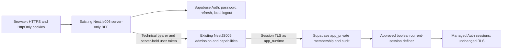

# Production Activation — Owner Plan Handoff

<a id="current-compact-resume"></a>

## CURRENT compact resume — 2026-11-13

This is the current compact continuation index. Older “Current …” sections below are retained snapshots; this section supersedes their status where they conflict. Canonical detailed design remains in [the incremental plan](plan.md#current-incremental-activation-plan-after-actual-roles-completion) and [existing task packets T179–T189](tasks.md#post-roles-incremental-activation-plan). No new tracker or task ID is created here.

**Task C update — 2026-11-14: BOOTSTRAP_COMPLETE.** Scoped Luna review accepted, then exactly one actual sealed finalizer completed verification and remote ACK. Execution675 has18 events/head9046ca2e2e8d67710c63cc99a4a3ff82f24c6a2c8ff4d6b101b40643315acdbf, next=app-config, with the original16-event prefix preserved. No product/Auth/DB replay or later phase occurred. [Actual completion](plan.md#actual-task-c-completion--2026-11-14) identifies immutable local receipts and limits. T184/Task C are complete; the next selected packet is D1/T185, not yet started. The older Packet A/B selection prompts and dirty-main snapshot below remain historical.

### Repository and verified position

- Repository: `e-commerce/esty-admin`; local branch `main` at `d3d2b0788d970377c9fee9d59c52e3d1baff7de2`. The worktree is dirty with existing BE source/tests, feature001 docs, and local helper files. Preserve every change; no cleanup/reset/staging/commit is implied. This handoff edit has a lease for this file only; OMP retains source, plan, tasks, quickstart and other paths.
- Execution `675b465c-f3cc-48e0-8994-7a3312970e53`: roles completed, count 2; migration committed exactly 2, TARGET postflight/remote ACK succeeded; separate TARGET no-op completed with count 0. These are actual receipts, not new executions.
- Bootstrap product and its postflight succeeded before the historical input-dispose STOP. Task B independently confirmed the exact committed profile/workspace/active-Owner/audit state. Task C subsequently finalized bootstrap verification and provider ACK; current675 has18 events, head9046ca2e2e8d67710c63cc99a4a3ff82f24c6a2c8ff4d6b101b40643315acdbf, next=app-config. **BOOTSTRAP_COMPLETE is established.** Do not replay the product call.
- Source explanation: `bootstrapInputs` returns a frozen validated record; the former adapter assigned it directly to an environment object and deleted keys during cleanup. The retained result proves product/postflight success and identifies cleanup as the stopping stage; no raw exception was retained. The older post-auth refusal remains unexplained. The owned-copy/idempotent cleanup correction and fixed read-only inspector were frozen **READY_FOR_FIX_INSPECTION** and subsequently accepted by the targeted fix-only inspection recorded below. [Exact handoff](../../.openai/reports/recovered-activation-zc_q5vob/bootstrap-continuation/retained-inspection/handoff.json) SHA256 `dfb81006cbe81f33d919c0f3a17f803d1a5ef888d01550773a11b4a0828ccc5a`; executable manifest SHA256 `ff8e58e2e9b2389e1026a73caf6898ab25bb045d945d7bd2dc9008bafb19878b`. Detailed evidence and retained failure disclosures are in [the current source/local plan](plan.md#fixed-retained-bootstrap-inspection-and-owned-cleanup--sourcelocal-authorization).
- Task A targeted fix-only inspection was accepted with no actionable findings. Task B executed the accepted helper exactly once: `INSPECTED / complete / passed / committed`, `cleanupFailed=false`, exit0. One bounded app_operator READ ONLY transaction verified the expected profile/workspace names, active Owner and matching audit. Journal head/events/inventory remained unchanged. [Task B handoff](../../docs/task-b-bootstrap-verification.md) records the exact local evidence and limitations; it is not an ACK or deployment receipt.
- FE final acceptance is not complete. The requested outcome is a usable HTTPS `app.lovora.us`, not BE health alone. [FE preparation](../../docs/fe-hosted-acceptance-prep.md) is complete as documentation only. Dashboard/settings/team bodies remain sample-only. Existing manual services and all historical records remain preserved. No owner input is known missing; do not request credential re-entry or reset identities.

### Durable evidence

Use these safe receipts and their exact digests; do not substitute synthetic smoke for an actual result.

- M1 roles: [actual result](../../.openai/reports/recovered-activation-zc_q5vob/roles-truthful-successor/actual-roles-result.json) — `b04ba9c984459a331e4de0fd43761e3d33c3c709ebd6aa40928d071f95eb85b5`; [durable outcome](../../.openai/reports/recovered-activation-zc_q5vob/roles-truthful-successor/actual-roles-durable-outcome.json) — `61cce407c12a2ecd930dbfcec6aa9f0cbf49a34b4cfd4d2bb11386df9feda3d4`.
- M2 migration/no-op: [migration result](../../.openai/reports/recovered-activation-zc_q5vob/migration-continuation/actual-migration-result.json) — `39a222a556f5363c4ed537a7d056b646b52b24d7b0f92965e1bfec928df4f8c8`; [durable outcome](../../.openai/reports/recovered-activation-zc_q5vob/migration-continuation/actual-migration-durable-outcome.json) — `247af859414b09ab1e0201e9da7a6c2c123a4c564efe8c033c382780dea89906`.
- Bootstrap invocation: [run receipt](../../.openai/reports/recovered-activation-zc_q5vob/bootstrap-continuation/pretransaction-continuation/immutable-receipt-fix/actual-product-bootstrap-run.json) — `85c8bb98438f3a50d42bac3c1a0febb42de307d36dd2f869b79f5f1caa845d58`; [static/durable analysis](../../.openai/reports/recovered-activation-zc_q5vob/bootstrap-continuation/pretransaction-continuation/immutable-receipt-fix/actual-product-bootstrap-static-analysis.json) — `74b7f23801d954505f77f4b7c90205db175f2fe80233b500393db834d3c1f265`; [durable outcome](../../.openai/reports/recovered-activation-zc_q5vob/bootstrap-continuation/pretransaction-continuation/immutable-receipt-fix/actual-product-bootstrap-durable-outcome.json) — `43ed2922a4e010558b08bc0413eef1fe011eceb74acc16766fcf210b1f01c453`.

Original `032 UNKNOWN`, `f63 rolled_back`, the original bootstrap attempt/observation, and all prior receipts remain immutable. The full safe evidence inventory and current hashes are in the linked plan/task artifacts; secrets and private payloads are never copied here.

### Ordered task packets — one active task at a time

| Packet / existing IDs | Owner lane and scope | Entry, checks and done evidence | Stop conditions |
|---|---|---|---|
| **A. Finish pre-start cleanup + fixed inspect-only source** / T184 | BE OMP, current local source increment. Use the same 675 execution/packet/identity. Fix cleanup with an owned mutable copy; add the fixed inspect-only selector. Keep the frozen validator, normal service Auth behavior, journal schema and legacy mutating fence. | Run affected cleanup/lineage/concurrency tests once, plus the existing isolated native read-only inspector journey if needed. Freeze exact source/runtime/test/migration-asset closure; coordinator performs targeted fix-only inspection. | Any mismatch, extra file, partial claim, unknown journal state or test/manifest drift. Stop READY_FOR_FIX_INSPECTION; no DB observation yet. |
| **B. One actual read-only bootstrap inspection** / T184 | BE OMP under existing owner START, only after A acceptance and fresh exact gates. Inspect current profile/workspace names, active Owner membership and exactly one audit through the existing bounded read-only inspector. No Auth diagnostic, product call, provider write, journal event, verification/ACK or new continuation. | Bind exact 675 head/events, claim/ready/terminal, fixed receipts, source/artifact and inventory; fresh local/main/bridge/exclusion and prepared BOOTSTRAP binding. Emit a separate sanitized observation only. Done means exact committed/absent/conflict classification, not bootstrap completion. | Any stale binding, changed inventory or unknown classification. No retry or product replay. |
| **C. Resolve bootstrap verification/ACK** / T184 | Coordinator + BE source owner, only after B. First prove the existing journal/receipt path supports a truthful completion from this exact committed outcome. | Compare the observation with the expected profile/workspace/active-owner/audit predicates and existing ACK contract. If a minimal adapter is needed, freeze/review it before any journal/provider write. | Do not turn the observation into a fabricated verification receipt or ACK; no event/status write until the supported path is accepted. Stop at the exact missing predicate/interface. |
| **D1. Strict BE configuration adapter** / T185 | BE OMP, a separate source/local slice after BOOTSTRAP_COMPLETE. Reuse strict configuration validation and the exact existing prepared app-config envelope; keep broad delivery disabled. | Focused configuration/recovery tests and exact sealed proof, then targeted inspection. Execution writes only the exact approved app-config destinations and requires durable ACK. | Unknown/partial write or stale source/config binding; no overwrite/replay or broad flag change. |
| **D2. Existing artifact app deployment and BE acceptance** / T186–T187 | BE OMP, separate bounded source/actual-effect packet after D1. Reuse immutable f162 artifact `13587251015`; distinguish BE source/artifact f162 from workflow/FE source. Inspect current provider/app adapters and receipt contract before implementation. | Same-artifact byte/runtime/config attestation, protected live/ready/TARGET/denial/CORS checks, same-ID promotion and final `api.lovora.us` TLS/alias proof. Exact receipts required; no artifact rebuild. | Unknown create/promotion or failed health stops with retained evidence. No second candidate, bridge replay, SQL rollback or broad delivery toggle. |
| **E. FE-owned browser acceptance** / T188; existing T169/T121/T122 | FE owner lane, only after BE receipts are ready and the existing FE owner accepts handoff. No FE worker tracking/contact or `apps/web` / feature006 edits without its lease. | Existing FE journey proves HTTPS login, real `/api/app/me` Owner/Lovora/workspace membership, protected application access, reload/refresh, logout and revoked-session denial at `app.lovora.us`. Record only actual FE-owned evidence. | Any challenge, wrong deployment/origin, missing membership/session revocation or incomplete journey means FE is not accepted. Sample dashboard remains sample data. |
| **F. Final evidence closeout; routine CI deferred** / T189 and M4 | Coordinator closes only proven M2/M3 gates after A–E. Publication/ordinary-push CI is a distinct later slice unless an exact reviewed dependency is demonstrated. | Preserve existing artifacts, exact current receipts, and all earlier UNKNOWN/failure disclosures. Update only the existing feature artifacts under a returned document lease. | No blanket Git staging/publication, CI redesign, broad delivery enablement or unsupported acceptance claim. |

Existing IDs T179–T189 remain as written in [tasks](tasks.md#post-roles-incremental-activation-plan); this compact map does not change their checkboxes. M2 migration/no-op have actual receipts even though composite legacy task rows remain open. Do not infer a task complete from the current journal head alone.

### Resume protocol and copy-paste prompts

Use the existing repository and live Herdr topology. At each handoff, run `hc ls` / `hc get` to resolve current terminal addresses; historical `t4q` and `t11c` are not durable addresses. Do not create a session now. Finish and freeze current packet A, then explicitly hand back its source ownership before selecting the next packet. An owner-selected future packet may use a fresh bounded conversation/session; it is not permanently tied to the current OMP history. Never overlap source writers, start scouts, or automatically retry a failed step. One active task per lane/session. At a 30-minute checkpoint, report the last verified step and exact blocker; this is a checkpoint, not a completion estimate. Failed steps stop with the safe category and retained receipt.

**Root / coordinator — select only the next packet (currently A):**

```text
Resume esty-admin from the existing repository only. Read AGENTS.md, PROJECT_STATE.md, specs/architecture.md, constitution, then this file at #current-compact-resume and the linked feature001 plan/tasks. Resolve live Herdr addresses; do not assume a prior terminal ID or create a session. Select only the next unfinished packet, currently A. Keep all dirty files. Do not run effects outside that packet. Accept the exact frozen closure before releasing any actual read-only or product step.
```

**BE OMP — Task A only:**

```text
In the existing assigned BE OMP session, resume packet A in specs/001-connectivity-foundation/production-activation-handoff.md#current-compact-resume. Confirm the current live terminal address before coordination; do not create another worker/session. Finish only the mutable-owned bootstrap cleanup and fixed inspect-only source/tests, preserve the exact 675 journal/receipts, run affected checks once, freeze the exact consumed closure including f162 migration assets, and stop READY_FOR_FIX_INSPECTION. No actual DB/Auth/provider/product call, no Git/publication, no later phase.
```

**FE owner — Task E only, when the coordinator later hands off:**

```text
Use the existing FE-owned lane/session only after BE supplies accepted exact deployment/config/bootstrap receipts and the coordinator hands off T188. Resolve live Herdr addresses; do not rely on historical terminal IDs or start a new session. Execute only the existing FE-owned HTTPS browser acceptance for app.lovora.us: login, real me Owner/Lovora/workspace, protected app, reload/refresh, logout and revoked-session denial. Preserve sample-only dashboard content and existing manual services. Report actual evidence or exact blocker; do not claim acceptance from BE health.
```

### Current gate

The documentation lease for this file is returned. Packet A source/local work is frozen **READY_FOR_FIX_INSPECTION**; OMP stops source writes and hands coordination ownership back for targeted inspection. Executable SHA256 `ff8e58e2e9b2389e1026a73caf6898ab25bb045d945d7bd2dc9008bafb19878b`; exact source/test/evidence handoff: `.openai/reports/recovered-activation-zc_q5vob/bootstrap-continuation/pretransaction-continuation/retained-inspection/handoff.json`. Corrected compilation0,61 non-native checks passed, corrected native5/5 and frozen native CLI-dispatch smoke passed; initial setup/typing/native-seed failures remain disclosed in the plan. No actual observation/ACK has been performed since the input-dispose STOP. Packet B remains gated on acceptance of this exact closure and fresh local/provider-read/input bindings; it permits one read-only DB observation only, not Auth/product, verification/ACK or later phases. Preserve the dirty worktree and every existing receipt; no credential re-entry/reset or new worker/reviewer.

## Current staged-bootstrap review handoff

**READY_FOR_REVIEW — actual bootstrap remains gated.** Existing675 migration/postflight/remote ACK and separate TARGET-only no-op completed: head `09384d5f5adcd4900f479f347f035926e3a2b7c1745ebcb8fdc9f15bced0025c`,12 events,next=bootstrap. Immutable actual migration result39a222/durable247af8 are retained under `migration-continuation/`. The later root/t11c START authorized the bootstrap-specific adapter because accepted seal8f1e has no675 bootstrap route.

Supported new interface: `reachability-bootstrap <state|authorize|run|inspect|confirm|reconcile-ack> <existing-control> <existing-control-digest> <existing-original> <verified-f162-artifact>`, through the sealed launcher only. No phase/head/execution override. [Prerequisites, implementation and actual local limitations](plan.md#bootstrap-sourcelocal-review-receipt) bind the approved identity/workspace/retention without reading other phase envelopes or creating/resetting Auth.

Evidence root `.openai/reports/recovered-activation-zc_q5vob/bootstrap-continuation/`; manifest `activation-executable.json`, SHA256 `f04bdbc27b2fce15b278163c110b25c4666784c275b2b75f7b630f5345244b90`. Compile0, native bootstrap16/16 with zero skips, emitted native smoke0, guarded refusals5/5, explicit recovery2/2 and phase isolation7/7. Initial fixture-origin failure and broader120s test-selection timeout remain disclosed; no full-suite or production-bootstrap success is claimed.

No actual BOOTSTRAP input/action occurred before this handoff. Coordinator owns the single scoped Luna inspection. Only acceptance plus fresh matching gates permits one actual bootstrap; failure/UNKNOWN permits inspection without write replay/new identity. Stop at BOOTSTRAP_COMPLETE before app-config/deploy/FE. Earlier handoffs and all032/f63/role/migration receipts remain historical and immutable.

## Current migration-only source/local handoff

**READY_FOR_REVIEW / STOP WRITES.** The later bounded START authorized the first T180/T181 subset only: fixed675 migration/postflight and separately fenced TARGET-only no-op. Bootstrap and later phases are rejected, not implemented by this increment. [Exact implementation, commands and failure disclosure](plan.md#migration-only-adapter--sourcelocal-review-handoff) supersede the earlier planning-only status below without rewriting it.

Final immutable helper: `.openai/reports/recovered-activation-zc_q5vob/migration-continuation/activation-helper-final/`; manifest `activation-executable-final.json`, SHA256 `8f1e50bb907abd56abcc01cafe8e4d1bd005d04d0bb4af31ca181fa56eb721ac`. `handoff.json` seals the three source/test paths and three feature001 documents; parent handoff98ab/seal239e and actual receipts remain unchanged.

Evidence: final compile exit0; native18/18 with zero skips; final emitted native migration2/postflight/ACK/no-op0 smoke exit0; five actual guarded CLI refusal probes pass. Existing67 recovery cases passed in the initial affected-file run. Retained failures disclose both the corrected COMMIT fault-injection target and the reproduced/fixed no-op refusal leaking the prior migration's committed/count2. Synthetic provider/configuration and disposable PostgreSQL17.11 Unix sockets do not establish production-input or hosted success.

Actual675 remains six roles-only events, head `68c594864050258ce965e3e6881dae4d6151ab45fa7faf80a0ba8d7253621c80`, next=migration;032 UNKNOWN and f63 failed/rolled_back inventories and role receipt hashes are unchanged. No actual migration, bootstrap, new successor, owner-input read, provider call, install, Git, deployment or FE/shared-document change occurred. Existing approved inputs are not requested again.

Next gate: coordinator-owned scoped Luna review and acceptance of confirmed fixes, then fresh exact state/assets/authority checks before the conditionally permitted single real migration/postflight/ACK and separate no-op. T180/T181 composite rows remain open for their excluded scope/review; T182 onward is not claimed complete. OMP does not start the reviewer or proceed to production on this receipt.

## Current plan after actual roles complete

**READY_FOR_OWNER_PLAN_REVIEW / STOP WRITES — PLAN/DOCS ONLY.** This is the current root t12p/t11c bounded handoff. Earlier missing-input/provider-context/roles-pending sections below remain historical. Existing Auth identity, Hieu/Lovora, approved workspace, manual-retention-v1 and prepared credentials are already approved; do not request them again. This static pass establishes **no missing owner input** and performs no private-input, account, DB or provider query.

### Actual baseline

Exactly one accepted guarded action reached `ROLES_COMPLETE`: execution `675b465c-f3cc-48e0-8994-7a3312970e53`, head `68c594864050258ce965e3e6881dae4d6151ab45fa7faf80a0ba8d7253621c80`, two committed roles, six roles-only events through remote-confirmed, next=migration. Exit0 in57.068s; no timeout/stderr. Local frozen readers verified role/credential receipts, immutable predecessor/correction binding, unchanged032 UNKNOWN and f63 failed/rolled_back inventories and six prior actual receipts.

Evidence root: `.openai/reports/recovered-activation-zc_q5vob/roles-truthful-successor/`. `actual-roles-result.json` SHA256 `b04ba9c984459a331e4de0fd43761e3d33c3c709ebd6aa40928d071f95eb85b5`; `actual-roles-durable-outcome.json` SHA256 `61cce407c12a2ecd930dbfcec6aa9f0cbf49a34b4cfd4d2bb11386df9feda3d4`. Accepted handoff98ab and executable239e remain frozen; this documentation update does not amend those receipts. No migration/bootstrap/app/FE effect followed M1.

### Existing code and precise gaps

| Increment | Existing implementation | Missing delta before execution |
|---|---|---|
| M2 migration/postflight | Versioned runner, exact f162 three-file manifest, OLD→TARGET worker/report and ROLE postflight/ACK | Current `recovered-activation` selects032, not675. Add fixed675 routing, the runner's existing under-lock expectedBefore binding, and a separately bound TARGET-only no-op receipt path. |
| M2 bootstrap | Existing Auth-verified profile/workspace/active Owner/audit transaction, fingerprint idempotency and read-only inspection | Route the same prepared envelope to675 only after migration/postflight/ACK/no-op proof; no new identity/model/input. |
| M3 strict config | Strict app_runtime/email-disabled validation, private-schema exposure inspection and Secret-write receipt | Fixed675 app-config route after bootstrap; configuration UNKNOWN remains fenced, not repaired by metadata or repeated writes. |
| M3 strict app deployment | Official immutable prebuilt candidate/attestation/promotion/health core | Recovered worker excludes app; provider only binds the bridge and four private-phase status names. Add bounded distinct-app/current-main/status/known-ID support and accepted transport normalization; do not rebuild f162. |
| M3 FE final acceptance | Existing FE-owned browser journey and provider FE receipt validator | Ordinary FE journal import cannot preserve the recovery-origin chain. Consume the separately supplied FE receipt in the existing675 root and add recovery-aware final ACK handling. |
| M4 routine CI | Existing routine source/workflow remains | Deferred; no broad flag change, auto-deploy redesign or new automation lane. |

**Next smallest executable increment:** source/local fixed675 migration/postflight adapter plus narrow lock/no-op guards and affected proof, followed by coordinator targeted inspection. No supported command in current seal239 can run675 migration; invoking its old selector would address032. This is an implementation gap, not missing credentials or a reason to create another successor.

### Increment order and observable exits

1. **M2a adapter/proof:** reuse existing phase functions and prepared contexts; preserve675's six-event prefix and both predecessors. Proposed `reachability-activation <action> <phase> <control> <controlDigest> <original> <artifact>` runs behind the existing hash-bound launcher only after implementation. It is **not supported today**; no execution/head override, roles replay or initialization.
2. **M2b exact migration:** fresh bridge/main/shared-exclusion/OLD plus retained f162 source/tree/artifact/checksums → authorize migration → run once → ROLE postflight → confirm. Existing node-pg-migrate applies exactly two pending files in one transaction. Save before=[foundation], after=full TARGET, matching attempted checksums/applied_committed, success/committed/reporting=written, postflight and remote ACK. Stop at the milestone; do not infer bootstrap authorization from next=bootstrap.
3. **M2c unchanged no-op:** proposed `verify-noop migration` after confirmed TARGET/postflight/ACK uses the same runner with expectedBefore=TARGET under its lock. Require before=after=TARGET, attempted=[], zero migration actions and a separate written head-bound report before bootstrap. Completed-phase replay is refused; retained synthetic2→0 does not substitute for this actual receipt.
4. **M2d bootstrap:** same prepared existing-user Hieu/Lovora/Owner binding → authorize/run/confirm bootstrap. Verify existing Auth user and exact transactional workspace/active Owner/audit. New exact commit count1 or exact-existing count0; conflict/partial/disabled state stops, never resets Auth or repairs Owner through replay.
5. **M3a/b BE:** existing strict APP configuration after bootstrap; same f162 artifact, official prebuilt/icn1/skip-domain candidate, durable acknowledged distinct ID, exact bytes and runtime-computed digest, protected live/ready/TARGET/denials/CORS, same-ID promotion and api.lovora.us TLS/alias proof. Secret-write UNKNOWN, unknown CREATE/promotion or failed health stops without retry, second candidate or DB rollback.
6. **M3c FE-owned usability:** existing FE owner receives BE receipts through the coordinator. Final https://app.lovora.us must demonstrate browser login, real `/v1/app/me` active Owner/Lovora/capabilities, protected app, reload/refresh, confirmed local logout and revoked old-session/JWT denial. Preserve exact source/config/deployment/domain/cookie/origin/CSP evidence and the existing FE receipt contract. Proposed in-place `reachability-frontend` consumes that receipt after strict app ACK; it does not build/deploy/contact/track FE or modify apps/web/spec006.
7. **M4 later:** retain routine CI as deferred. Sample dashboard/Settings/Team remain **sample-only** even after authenticated access works.

For every increment, retain precise safe stage/category/database disposition and durable report/head. `inspect` is read-only reconciliation, not a retry; exact TARGET or bootstrap commit may support append-only reconciliation without rewriting an original UNKNOWN. ACK-only continuation verifies exact remote intent/outcome and does not rerun DB/config/provider effects. Configuration missing write ACK cannot be inferred from Secret metadata. No down/reset/unlock,699 fallback after schema commit or new activation identity. T108 stays UNPROVEN; T110 historical503 stays NOT REPRODUCED / CAUSE UNPROVEN.

[Detailed preconditions, exact existing/proposed interfaces, asset checksums and failure handling](plan.md#current-incremental-activation-plan-after-actual-roles-completion) · [Dependency-ordered T179–T189](tasks.md#post-roles-incremental-activation-plan). T169/T121/T122 retain FE acceptance ownership; there is no new FE tracker or contact in this assignment. Shared README/PROJECT_STATE, source, specs005/006 and all final receipts remain untouched. Planning completion is not live continuation authority.

Planning verification is document-only: original bytes/checkmarks are preserved across the three edited files; the184 historical task rows include seven pre-existing T139 rows, which are intentionally not renumbered. An initial whole-file uniqueness assumption detected that inherited duplication; scoped checking confirms all11 added IDs T179–T189 are unique and previously unused (one completed documentation task, ten future tasks). One newly added handoff fragment was corrected. Link/fence/whitespace and scoped FR/SC/dependency consistency checks do not constitute runtime, test/build or independent code-review evidence. No new blocking plan inconsistency is identified; the explicit implementation gaps above remain future work.

## Current continuation — retained manual workflow READY_FOR_REVIEW

The latest bounded source/local grant implemented the existing workflow's separate manual retained-artifact path, two new API control/validation modules and focused CI regressions. The ordinary broad delivery gate remains closed unless separately enabled; explicit activation selects only run42404748672/artifact13587251015 and unchanged f162/tree181b2c01/artifact82419e36/archiveadb37e90. Retrieval and provider execution are separate least-privilege jobs, connected only by a verified unchanged-archive/selection transport relay.

The actual reviewed workflow head/run and immutable release source/tree are independent, truthful identities. The trusted manual control runner uses supported unchanged sealed exports/CLI, a real live-main/source check, phase-specific credentials and durable unknown-state fences. No fake GitHub metadata, `GITHUB_SHA` substitution, f162 rebuild or broad GitHub variable toggle is used. Fresh private operator compatibility markers stay process-local.

Actual OMP evidence: isolated compilation0; affected network-denied CI66/66; pinned Linux/x64 Node24.22.1 focused9/9; actual selector/archive/extraction/full-bundle/preflight/sealed-prepare/manual-reserve CLI smoke0 with one synthetic reservation and repeat refusal1, zero phase effects. Workflow parsing/41 shell checks,480 local routing scenarios and96 actual completion-shell scenarios passed. Lost reservation acknowledgement, main drift and predecessor drift remain fenced. All provider/GitHub responses in the smoke were synthetic; no external operation occurred.

[The current validation contract and limits](quickstart.md#retained-artifact-manual-workflow--ready_for_review) identify `.openai/reports/retained-manual-ci5o5yfc/verification.json` and the exact eight-path `handoff.json`. Coordinator-attributed gh-lovora names-only clearance resolves the earlier profile403, not transfer authority; OMP did not repeat account inspection. Existing real inputs, original private bindings, f162 and UNKNOWN81d4/454 remain untouched. No re-prepare, auth-store access, secret/variable write, publication, workflow dispatch, provider/SQL/config/bootstrap/deploy, FE or shared README/STATE action occurred.

**READY_FOR_REVIEW / NOT_READY_TO_CONSUME_EXISTING_INPUTS / NO_INFLIGHT / STOP WRITES.** Coordinator t11c alone starts ONE new scoped gpt-6-luna review. No new review has run; previous helper acceptance is not substituted. Review acceptance, separately authorized publication, public packet/workflow approval and fresh retained-artifact preflight precede any separately authorized real transfer/dispatch. Historical missing-channel/check-only/failure receipts below are preserved, not current source-status or repeated-input instructions.

## Current continuation — review accepted; actual worker dispatch proved; provider context missing

Coordinator t11c accepted the ONE scoped gpt-6-luna review with no actionable findings and an exact nine-path manifest match; reviewer tests: none. The reviewed E2E was check-only, a retained limitation rather than production proof. Subsequent static inspection found the actual guarded adapter already present, so no source patch or review cycle was started.

The new network-none synthetic probe observed all five real child invocations of unchanged f162 `activation.js` through `handoff`, with the exact seven-argument contract. All children fenced/exited1; no successful phase effect, production CLI execution or reserved journal was fabricated. Two input/binding tamper cases refused before child creation without input-value output. The actual OrbStack command prefix and initial probe failures are retained in [the current continuation guide](quickstart.md#current-continuation--review-accepted-real-dispatch-proved-provider-execution-context-gated).

Actual continuation is **PROVIDER_EXECUTION_CONTEXT_MISSING / NOT_READY_TO_CONSUME_EXISTING_INPUTS**: the isolated provider credential names are absent and no later complete approved packet/reservation channel was supplied. Five prepared phase inputs are not the separate provider reserve/authorize context. Keep those inputs untouched; no re-prepare, cache extraction, configuration-token repurposing, broad toggle or historical replay/unlock. Coordinator receives exact evidence and the supported-channel prerequisite, not a request for secret values or another review. **NO_INFLIGHT / STOP WRITES.**

## Current continuation — portable helper READY_FOR_REVIEW; real consumption held

Separately authorized acquisition of the exact pinned official Node image cleared the prior runtime-availability gate. The new guarded portable helper now has actual Darwin/arm64-to-Linux/x64 synthetic check-only proof: all five phases accepted; token-byte/artifact/runtime/path/phase/mode/symlink tampering refused. Corrected compilation0, affected tests32 PASS/1 opt-in skip, actual Linux E2E1 PASS and post-correction launcher7/7 PASS are OMP evidence. The initial compile and actual Linux runtime-owner failures remain recorded; no independent review has run.

[The current continuation guide](quickstart.md#current-continuation--portable-helper-ready_for_review-existing-inputs-remain-held) specifies the version2 executable identity, new digest-bound `bind-handoff` / `check-handoff` / `handoff` contract and exact receipts. Existing real prepared inputs remain unread/unhashed/unmounted; no prepare retry, f162 rebuild or real phase occurred. Historical nine-argument handoff and runtime-blocked wording below are not current executable contracts. Actual provider/config/SQL/bootstrap/deployment and a real activation packet remain outside this synthetic increment.

**READY_FOR_REVIEW / NO_INFLIGHT / STOP WRITES.** Coordinator t11c alone starts the one scoped gpt-6-luna review against the frozen `cross-platform-resume-bhwcyrpm/handoff.json`. **NOT_READY_TO_CONSUME_EXISTING_INPUTS** until review acceptance and separate explicit authority. Historical acceptance/failure/one-prepare receipts below are preserved, not repeated authorization.

## Latest continuation — BLOCKED_DEPENDENCY; existing inputs preserved

Owner INPUTS_READY was followed by successful supplied-directory metadata verification, not activation: the accepted Darwin-bound helper cannot satisfy its own Linux/x64 handoff gate. The new synthetic-only source/local START permits a guarded transport correction only with a supported isolated runtime. Actual read-only checks found the approved Node24.22.1 Linux/x64 image/index/child/config absent on the active local daemon, no existing isolated Node container, and the historical daemon socket absent. No installation, pull, container/service start or unrelated-service use occurred.

**Implementation: NO. Cross-platform runtime exercised: NO. New review: NO. Ready to consume existing inputs: NO.** The exact dependency evidence and permitted next prerequisite are in [the current continuation guide](quickstart.md#current-continuation--linux-runtime-dependency-blocked-preserve-existing-inputs). All owner inputs remain unread/unhashed/untouched in this increment; no prepare retry, real payload use or provider/config/SQL/bootstrap/deploy. Actual synthetic transfer/refusal checks and the coordinator-owned scoped gpt-6-luna review remain gates. **NO_INFLIGHT / STOP WRITES.** Earlier one-prepare and inspection receipts below are historical, not repeat authorization or cross-platform proof.

## Latest helper status — inspection accepted; one owner-operated prepare

Coordinator t11c accepted the targeted diagnostic-fix inspection with no actionable finding, confirming handoff/verification/executable hashes and all seven changed-path hashes. OMP's existing checks were not rerun or independently verified. Owner/t4y's subsequent decision lifts REAL_INPUT_HOLD for exactly ONE owner-operated corrected prepare using the accepted `guarded-diagnosis-wixzokt9` executable and unchanged request. [Current authorization and exact unchanged command](quickstart.md#current-authorization--inspection-accepted-one-owner-operated-prepare) supersede the historical pending/HOLD status below only for this one attempt.

Actual owner failure cause remains **UNPROVEN**; authorization is not an observed execution/result. No second retry, agent helper execution, owner-output polling/collection or provider/SQL/config/activation is authorized. This additive docs-only closeout changes no source/test/executable or prior receipt and starts no reviewer/check/helper. **FIX_INSPECTION_ACCEPTED / ONE_OWNER_PREPARE_AUTHORIZED / NO_INFLIGHT / STOP WRITES.**

The following diagnostic status is retained as historical evidence, not a pending coordinator inspection:

## Current secure-input helper — FIX_READY_FOR_INSPECTION / REAL_INPUT_HOLD

The owner reports `HELPER_EXECUTABLE_REFUSED` after the latest real input collection. Cause is not established. No further real-input attempt or external effect is authorized during diagnosis; accepted P2/P3 and automatic-composition evidence below is retained, not a reason to bypass this hold. Synthetic exact-command probes confirmed an error-label defect and cleanup masking, not the owner's actual input failure.

The confirmed helper/launcher masking defects are corrected without relaxing validators or executable guards. Actual compilation0, network-denied22/22 affected tests and corrected exact-command positive/three validation-negative/owned-copy drift smokes passed. Cleanup refusal preserves the primary bounded diagnostic; child output remains suppressed. The unchanged request/identity is retained, and the original owner's failing field/cause is still UNPROVEN. [Corrected held command and diagnostic evidence](quickstart.md#corrected-diagnostic-evidence--awaiting-targeted-inspection) await coordinator targeted inspection; no new reviewer, real-input retry, provider/SQL/config/activation or f162 rebuild is implied. **NO_INFLIGHT / STOP WRITES.**

The earlier accepted state below remains historical context, not a release of the current HOLD.

The latest owner explicitly resolved the historical recovery-authority gate by preserving81d4/454 unchanged as UNKNOWN and permitting a separately identified activation after bounded current-state reconciliation. Actual read-only reconciliation found E7FEL still READY/aliased at api.lovora.us, foundation-only history, no app_private schema and no application roles/functions. The verified f162/Linux artifact82419e36 is retained unchanged; no repeated artifact audit or production effect followed.

T136–T138 provide hidden-TTY preparation; the accepted T139 P2 fix binds executable/import/runtime bytes before prompting. The subsequent requirement correction now **constructs all five phase maps internally** from the approved request/target and individual hidden inputs. No owner-authored JSON or full DB URL is requested. [Current exact guarded command, minimal fields, cleanup and actual evidence](quickstart.md#hidden-tty-activation-input-helper). Missing nonsecret fields are explicitly `APP_OPERATOR_USER_ID` and `APP_AUTH_API_KEY`; the six credential prompts collect one config token, three distinct raw DB passwords, existing bearer and bootstrap admin key. Bound public metadata is reused without prompting. Only matching fixed validation workers receive generated envelopes; preparation performs no activation. Existing workspace/Auth/run/Hieu/Lovora/manual-retention are not recreated or queried.

`VERCEL_CONFIGURATION_TOKEN` is a config-only destination. A compatible existing Vercel token may be entered once and reused for both configuration phases; no duplicate credential or auth-store extraction is required. Public/previously configured fields are distinguished from the genuinely required secret values in the linked input list. GitHub secret storage alone is not this local worker channel and does not execute activation or justify broad enablement.

The original T139 two-finding P2/P3 review and accepted fixes remain intact. Coordinator t11c has also **accepted automatic composition through read-only fix-only inspection**, confirmed all11 handoff hashes matched and found no additional actionable issue. No new reviewer or check rerun occurred; compilation0, helper14+launcher6 tests20/20 and guarded-command eight-field/zero-JSON/five-child/discard smoke0 remain OMP evidence, not independently rerun verification, with initial failures retained. This docs-only closeout performs no source/check/real-input/provider/SQL/activation work. Owner-only individual-field preparation, a complete independently approved packet and separately authorized sealed-worker execution/strict BE/FE acceptance remain gates. All16 historical records and81d4/454 UNKNOWN, existing private identities/manual-retention, f162, FE/manual006/3000/010 and earlier evidence are unchanged. **READY_FOR_OWNER_MANUAL_INPUTS / NO_INFLIGHT / STOP WRITES.**

## Current Secret-protocol action packet — source/local only

Root accepted the one-way Secret proof-order amendment; T132–T135 are **SOURCE/LOCAL REVIEW COMPLETE**, not production acceptance. Coordinator t4v reports one scoped read-only gpt-6-luna T135 review, no actionable findings and all8 reviewed hashes matched. Reviewer ran no tests and did not independently verify OMP check results; no source fixes or reruns followed. The historical proposal/status/retention-duration text below is retained as history: the current approved policy is **manual-retention-v1**, with no scheduled age-based expiry or automatic purge and no TTL/session/token changes. Hieu/Lovora and the existing privately bound workspace/run are already approved; do not regenerate them or request another general START.

### Secure input names, destinations and formats — no values

During the historical T135 documentation-only closeout, no hidden-TTY collector existed and no inputs were collected. T136–T138 subsequently implemented the preparation channel linked above; both original T139 findings are now accepted as resolved through coordinator fix-only inspection, not a second full review. After owner preparation, inject only the matching worker's process environment through the protected workflow environment or approved private operator channel. Original-file/auth-store reads, secret argv/chat/log, blanket environment export and automatic bearer rotation remain prohibited.

| Protected workflow secret name | Worker environment destination | Format and allowed use |
|---|---|---|
| `BE_ACTIVATION_BRIDGE_INPUTS` | `ACTIVATION_BRIDGE_INPUTS`, bridge configuration worker only | UTF-8 JSON object with runtime-base string fields below; canonical digest must match packet `bridgeConfigDigest` |
| `BE_ACTIVATION_APP_INPUTS` | `ACTIVATION_APP_INPUTS`, strict app configuration worker only | Runtime-base plus app string fields; digest matches `appConfigDigest`; existing private workspace/retention binding |
| `VERCEL_CONFIGURATION_TOKEN` | Same name, configuration workers only | Opaque printable token string; authenticated HTTPS header, never provider-CREATE worker input |
| `BE_ACTIVATION_ROLE_INPUTS` | `ACTIVATION_ROLE_INPUTS`, role/preflight/postflight worker only | JSON string map: migration fields plus `APP_ROLES_APPROVAL_ID`, `APP_ROLES_CONFIRM_TARGET`, `APP_ROLES_RUNTIME_DATABASE_URL`, `APP_ROLES_OPERATOR_DATABASE_URL`; digest matches `roleInputDigest` |
| `BE_ACTIVATION_MIGRATION_INPUTS` | `ACTIVATION_MIGRATION_INPUTS`, migration worker only | JSON string map: `MIGRATION_TARGET`, `MIGRATION_DATABASE_URL`, `MIGRATION_CONFIRM_PROJECT_REF`, `DATABASE_URL` and Session metadata; digest matches `migrationInputDigest` |
| `BE_ACTIVATION_BOOTSTRAP_INPUTS` | `ACTIVATION_BOOTSTRAP_INPUTS`, existing-user bootstrap worker only | JSON string map: app/Session metadata and `BROWSER_ORIGIN`, plus `APP_OPERATOR_TARGET`, `APP_OPERATOR_DATABASE_URL`, `APP_OPERATOR_AUTH_KEY`, `APP_OPERATOR_CONFIRM_WORKSPACE`, `APP_OPERATOR_APPROVAL_ID`, `APP_OPERATOR_USER_ID`, `APP_OPERATOR_PROFILE_NAME`, `APP_OPERATOR_WORKSPACE_NAME`, `APP_OPERATOR_CONFIRM_PROJECT_REF`; exact bootstrap input/identity digests |
| `VERCEL_TOKEN`, `BE_PREVIEW_ACCESS_KEY`; job-scoped `GITHUB_TOKEN` | Same names, provider authorization/confirmation and candidate acceptance workers only | Opaque provider tokens and fixed64hex technical bearer; no DB/runtime/Auth-admin envelope |

Runtime-base field names: `API_RUNTIME`, `DATABASE_URL`, `BROWSER_ORIGIN`, `PREVIEW_ACCESS_KEY`, `APP_SCHEMA_MODE`, `APP_FOUNDATION_ENABLED`, `SUPABASE_PROJECT_REF`, `SUPABASE_SESSION_HOST`, `SUPABASE_DATABASE_NAME`, `SUPABASE_DATABASE_USER`, optional `DATABASE_CA_PEM`. App additions: `APP_WORKSPACE_ID`, `APP_AUTH_URL`, `APP_AUTH_API_KEY`, `APP_EMAIL_ENABLED`, `APP_RETENTION_POLICY_ID`. Session metadata means the `SUPABASE_*` fields above and optional CA. JSON values are strings, at most16384 characters each, no NUL; the decoded envelope is bounded to65536 bytes. Encode PEM newlines as JSON string escapes. Exact URL/role/TLS/UUID/key-class validation remains authoritative; runtime Auth keys must be publishable/legacy-anon, while bootstrap Auth-admin authority stays isolated.

The configuration worker derives `APP_ACTIVATION_CONFIG_DIGEST` from the approved packet and sends approved values only in an authenticated HTTPS JSON body with Secret type and exact Production target. The durable receipt contains public identities/digests/counts only and records `valueProof=pending-candidate-runtime`. It never includes runtime values. Actual startup-computed protected configuration equality on the same immutable candidate is still required; metadata, returned IDs or the expected-digest variable alone cannot authorize promotion/roles/SQL. A lost/partial write ACK or missing receipt remains UNKNOWN; no metadata-only reconciliation or rewrite/replay.

FE-owned server-only input names remain `APP_SESSION_MODE`, `APP_ORIGIN`, `APP_API_ORIGIN`, `APP_AUTH_URL`, `APP_AUTH_API_KEY`, `APP_API_TECHNICAL_KEY`, `APP_SESSION_COOKIE_KEY`. The FE owner supplies exact source/configuration/acceptance receipts separately after strict BE acceptance. This packet does not configure FE, infer authenticated acceptance from an alias or enable broad BE delivery.

### Remaining ordered gates

Completed prerequisite: T135 scoped review, with no findings or fixes. Original reviewed manifest `.openai/reports/secret-protocol-dbx3mt02/handoff.json` remains unchanged; `.openai/reports/secret-protocol-dbx3mt02/review-closeout.json` records the current source/documentation manifest and attributed review evidence.

1. Separately authorized corrected-source publication, clean tested Linux artifact and explicit corrected activation packet binding. The retained b3 artifact is pre-fix, not relabeled or rebuilt here. Preserve existing private identities and the manual-retention-v1 decision digest.
2. Keep81d4/454 fenced: obtain the missing original sanitized execution-command/mount/container-identity provenance, then observe only the established original namespace under bounded authority. The documented temporary evidence and default Docker socket were unavailable; device/inode mismatch is not repaired or treated as corruption proof. If original provenance cannot be recovered, require an explicit evidence-loss disposition, not unlock/rebind/replay.
3. Only after those gates, bind the private inputs above and authorize actual ordered activation. Strict BE and historical-fence receipts precede separate final-origin FE acceptance. No cloud configuration/SQL/bootstrap/deployment action or production-ready claim occurred in this increment.

Actual affected checks, original failing-before regression, read-only forensic limits and preservation are in [the plan](plan.md#actual-secret-protocol-sourcelocal-evidence--ready_for_review) and [validation receipt](quickstart.md#secret-compatible-activation--affected-sourcelocal-validation). T108 remains UNPROVEN; historical T110503 remains NOT REPRODUCED / CAUSE UNPROVEN. Manual006/3000/010 and all16 historical fingerprints remain preserved. **REVIEW_COMPLETE — ACTIVATION_GATED; NO_INFLIGHT / STOP WRITES.**

## Historical planning handoff — retained, not current authority


**Status: READY_FOR_OWNER_PLAN_REVIEW — STOP WRITES after final receipt.** This is feature001's complete activation proposal, not permission to implement, publish, read private inputs/accounts, run SQL or deploy. Existing main/reviewed work is preserved; no new feature or tracker.

## What exists and what is missing

- **Accepted:** [005 BE foundation](../005-app-foundation/quickstart.md), [006 corrected local session journey](../006-login-session/quickstart.md) and its [frozen BFF contract](../006-login-session/contracts/session-bff.md), canonical OpenAPI0.4.0, ordinary versioned migration runner and existing Vercel projects.
- **Owner-reported, not queried again:** the existing Auth identity was created and password login PASSED. No app Owner exists. Cloud app tables/session function/runtime/operator roles are reported absent; no app schema was applied.
- **Missing implementation:**001 schema-changing durable orchestration/secure phase inputs, reviewed role provisioning/reconciliation, strict two-history bridge and FE nonce CSP. Current `ci-delivery.ts` is OLD/current-only with no migration runner invocation.
- **Missing release proof:** new scoped checks/review, exact publication/source tree, clean Linux artifact, compatible predecessor, actual roles/migration/bootstrap, strict BE/FE deployment and real HTTPS browser acceptance. Prior699 health PASS and reported `97000fa` publication do not include dirty006/new activation work.
- **Not included:** connected007/008/009 bodies, SMTP/email flows,010 Etsy integration, new infrastructure, Render, paid upgrades or automatic cleanup. Sample Application/Settings/Team content remains truthful and unconnected.

## Architecture and sequence



The browser never receives a technical/admin/DB/bypass key or a readable Auth token. Nest checks current session and membership on each protected request; role metadata and UI labels do not grant access.

| Stage | Required exit before proceeding |
|---|---|
| S0 Approve → implement → local proof → one later Luna review → publish → Linux build | Exact accepted005/corrected006/source/tree/contract/migration/artifact inventories; FE production assignment held |
| S1 Durable intent and read-only preflight | Exact target/TLS/OLD/predecessor/role capability, approved secure inputs and actual backup/protection boundaries |
| S2 Deploy compatible disabled-app bridge | Exact tested artifact/files/configuration, known deployment ID and actual API domain proof before any live SQL mutation |
| S3 Provision roles → migrate | Separate least privilege; durable confirmed TARGET transaction and actual ACL/definer evidence |
| S4 Bootstrap existing Auth user | Approved exact private workspace/user/names/approval; one atomic profile/workspace/active Owner/audit outcome |
| S5 Strict app BE → S6 held FE candidate → final HTTPS | Same approved BE bytes; app_runtime/email disabled. FE candidate gets source/build/configuration and bounded noncredential checks, then durable same-candidate promotion; full login/session proof runs only at final APP_ORIGIN, never a different generated hostname |
| S7 Observe and close | Safe redacted health/errors, exact evidence/limits and explicitly released test-only cleanup; no unresolved outcome |

### Why the bridge is required

**Recommended:** disabled-app readiness supports only exact OLD or full TARGET; strict app mode supports TARGET only. OLD is `243818c0ebe11bc6ea8b12b3224810c88e888b18ec30dd5bfe58394f1f209496`; TARGET is `149cb530551c0f0e2b734c1aa1086eac5615e01ebca152a8203490c8d93200c3`. The original migration remains an immutable prefix of the three-file target.699 rejects added history, so live SQL cannot precede a verified bridge unless the owner expressly elects bounded maintenance.

No arbitrary prefix/future history or baseline flip. The bridge artifact still honestly contains all three TARGET files. A two-entry partial history is rejected. OLD→TARGET applies **two files in one transaction**, then0 on repeat; this is one approved transition→zero new transitions, not a fabricated applied1 count. Historical foundation-only1→0 remains unchanged.

Unknown role/SQL/bootstrap/create/promotion outcomes fence the next phase and rerun. Persist intents before effects and known IDs before inspection; reconcile read-only before explicit continuation. After SQL commits, no699 rollback/down/reset; a bridge fallback restores only foundation health, not app availability. Provider rollback cannot undo DB/Auth or refresh old deployment variables. Full design: [A2–A5](plan.md#a2--ordered-activation-and-the-minimal-bridge).

## Grouped decisions for the owner

| Decision | Concrete proposal / boundary |
|---|---|
| Display and workspace | Profile **Hieu**, workspace **Lovora**, both reviewable display names only. Approve one workspace UUID later through the private channel; public docs use only `OWNER_AUTH_USER_ID` for the existing Auth user. No real identity/password/UUID in chat or this document. |
| Retention | Proposed `internal-launch-retention-v1`: active records for workspace lifetime; disabled identifying profile names and terminal invitations90 days; app audit365 days, retaining minimal disabled identity/membership links needed by those audit foreign keys; redacted release evidence for project lifetime. Manual review/anonymization/deletion only through a separately approved safe procedure; no automatic purge/Auth deletion or legal-compliance promise. |
| Cutover, only if not using the recommendation | Accept the bounded bridge, or expressly elect a dated/bounded maintenance window with app/API outage and recovery limits. No implicit downtime approval. |

Initial **application email delivery is disabled**; keep the already working Supabase email/password sign-in provider unchanged.007/009 SMTP is not a blocker for this confirmed password user. Lost-Owner recovery remains out-of-band identity verification + explicit approval + supported provider recovery/session revocation; retain current workspace/role and never reactivate a disabled member or replay bootstrap as repair. An unrecoverable final Owner needs a separately reviewed audited procedure, not an invented replacement.

## One owner authorization checklist

These unchecked gates are requests for later decisions/evidence, not claims that execution has happened. Detailed work is [T095–T123](tasks.md#story-8--complete-production-activation-p1-plan-only).

- [ ] Approve the grouped name/workspace/retention and recommended bridge decisions; scope the next source/local increment without authorizing cloud/publication implicitly.
- [ ] Confirm the plan's exact OLD/TARGET/source/artifact binding, current-only preservation, durable unknown-outcome stops and post-commit recovery/backup limits are acceptable.
- [ ] Grant exact BE/FE/workflow/resource leases; preserve manual006 until explicit stop/release. Obtain the actual final-domain caller/protection decision before implementation freeze/review, without automatically disabling protection or adding an unused bypass path.
- [ ] Require meaningful affected local functional/HTTP/DB/migration/native/security/browser proof, including real non-NULL local Auth timebox expiry, then one available scoped Luna review and owning-lane fixes.
- [ ] Separately authorize exact serial publication/build; hold FE production assignment before a source push and approve the clean Linux BE artifact plus exact FE source/build candidate identity.
- [ ] Separately authorize new secure role/migration/bootstrap inputs and live preflight/bridge/SQL/bootstrap/BE/FE operations in that order. Existing converted originals remain untouched; runtime receives no operator/admin/service key.
- [ ] Require real exact-deployment HTTPS Owner login/current workspace/capabilities/protected routes/refresh/confirmed local logout and old-JWT denial; synthetic Member/missing/disabled/demoted/revoked cases, public/mobile/keyboard/CSP/cross-user checks and honest hosted timebox limits.
- [ ] Accept only actual final receipts, unresolved-gate disclosure, safe health/error observation and explicit test-resource/lease return; no production destructive/load test, paid upgrade or automatic manual006 cleanup.

Configuration names and boundaries: [A7](plan.md#a7--capabilities-fe-boundary-and-names-only-configuration). BE uses app_runtime, exact Auth issuer/JWKS/workspace/retention, technical bearer and verified Session TLS. FE keeps `APP_SESSION_MODE=hosted`, `APP_ORIGIN`, `APP_API_ORIGIN`, `APP_AUTH_URL`, `APP_AUTH_API_KEY`, `APP_API_TECHNICAL_KEY`, `APP_SESSION_COOKIE_KEY` server-only; actual HTTPS cookies are `__Host-`/Secure/HttpOnly with exact origin/CSRF/return-path rules. The actual BFF caller, not an acceptance-tool bypass, must work through platform protection.

## Stable ownership and retained resources

BE OMP t4q owns future `apps/api/**` and001; workflow changes need their exact lease. FE OMP t4p alone owns `apps/web/**`; coordinator t4x controls FE/005/006 documentation leases. Release coordinator t4v owns cross-lane ordering/publication/release permissions and the one later review. Owner/brainstorm t4y receives this handoff. No new agent/reviewer starts now.

Read AGENTS → PROJECT_STATE → architecture → constitution →001 spec/plan/tasks and linked005/006 before future implementation; use the installed local Spec Kit workflows and `vercel-react-best-practices` for React/Next.js changes. No root dependency/pointer/canonical migration/contract change is implied.

Manual006 nonce `3073584d0a78c78355c75e5d0665ea4d`, FE t6h/API t6f/forwarder t6c/accounts/ports55440–55444 stay KEEP-RUNNING. Owner preview3000/default `.next`, shared services and volumes remain untouched. No resource health or private-file check was performed by this planning work.010 stays DONE/STOP WRITES;005/006/source/shared docs are only referenced, not edited.

## Coverage and actual planning checks

[Coverage table](tasks.md#activation-dependencies-and-coverage): FR-030–FR-043 and SC-019–SC-026 map to unchecked T095–T123. [Validation plan](quickstart.md#production-activation-validation-plan) separates documentation, future local and future hosted evidence; [research](research.md#complete-production-activation-decisions) records observed source, official citations and limits.

The first read-only analysis found one HIGH and three MEDIUM documentation gaps. **A01–A04 are now RESOLVED in this scoped document recheck**; original findings remain below, not rewritten as a no-findings first pass. No confirmed blocking documentation gap remains; owner decisions and later implementation/provider permissions intentionally remain open. This is not an independent code review or behavioral test.

| Finding | Original severity / evidence | Scoped repair |
|---|---|---|
| A01 | HIGH; draft T121/quickstart candidate-login order versus frozen006 exact Origin/Host contract | Candidate metadata/noncredential checks → durable promotion → full session proof at final APP_ORIGIN; no origin relaxation/rebuild |
| A02 | MEDIUM; draft CSP scope and nonexistent layout targets | Existing page targets, full-document public/protected crossings, explicit style-attribute allowance and navigation/hydration checks |
| A03 | MEDIUM;90-day profile retention versus365-day audit foreign keys | Explicit minimal identity-link retention through referenced audit lifetime; identifying-name anonymization requires approved procedure |
| A04 | MEDIUM; runtime no-service-key intent lacked assigned key-class checks | BE/FE hosted publishable/legacy-anon validation and privileged/unknown-class refusal/tests; operator key remains separate |

Actual documentation checks:

- Three command-local001/NO_PERSIST prerequisite checks succeeded; no extension hooks, template reset, branch operation or pointer write.
- 14 new FRs +8 new SCs mapped22/22;29 unchecked new tasks; all123 IDs unique/sequential, no orphan new task. All94 original task rows and the five original document prefixes are byte-identical.
- 26 new local Markdown links /16 fragments resolve; new fences balanced, no trailing-whitespace lines or actual email/identity-UUID literals.
- 214 protected public files unchanged, including005/006/010, BE/FE source, canonical/generated/migrations, root/shared files, pointer and workflow. Protected path→SHA256 map digest: `611fb299934ea5e2ce3e8be37556db14da002fdf9a0863811d1309b2130f6b95` (SHA256 of sorted compact JSON).
- Canonical0.4.0 and both OLD/TARGET migration digests match the preserved source. Existing source publication97000fa remains coordinator-reported, not rechecked with Git.

Only the five existing001 documents and this handoff were written. No runtime/test/build/install/Git/private/account/SQL/deployment/DNS action, resource probe/cleanup, new reviewer or production acceptance. Manual006 remains KEEP-RUNNING; no temporary repository script or new runtime resource was created by this planning increment.

## Subsequent source/local execution status

The preceding sections retain the original planning-only evidence. The later explicit owner START authorized T095–T111 source/local work; actual decisions, failures and checks now live in [the implementation record](plan.md#independent-be-implementation-and-actual-checks), [task status](tasks.md#current-sourcelocal-authorization) and [validation receipts](quickstart.md#verified-be-activation-increment-and-execution-boundaries).

- BE T097–T102/T105–T107/T109/T111 source/local checks are recorded. Synthetic CI31/31, affected integration28/28 and corrected private-TMPDIR release121/121 passed; original failed/timed-out attempts remain retained. Real Auth/application evidence is the separately recorded18/18 run, not the structural role smoke.
- Native02 artifact `56286e996c114bc16b297dcf7467744affb3eb4b6d0697e9f17f2244182baa58` passed actual sealed HTTP/TLS/cancellation and bridge OLD→TARGET2→0 smokes. Darwin/arm64 development output remains **NONRELEASABLE**; actual Linux/provider/hosted proof is absent.
- BE source freeze binds89 native inputs, the unchanged canonical/generated/migration hashes and additional workflow/example files. The exact receipt is linked in the plan; T096's coordinator publication allowlist/FE hold remains open.
- T108 is explicitly **UNPROVEN and unchecked**. Pinned password/global30s timeboxing yielded NULL `not_after`, valid-JWT `/me`200 before/after31.97s and refresh400/`session_expired`. Root accepted this as a supported refresh-enforcement observation, not non-NULL coverage or a demonstrated bug. No further timebox experiment/workaround is authorized; the precise coverage gap still needs owner acceptance.
- T110's historical natural300s BFF503 remains unexplained. One newly authorized diagnostic has fresh bilateral resource/source/configuration binding and BE_READY; exclusive FE_BROWSER is active under nonce `111c9db9e9a94eb3529024a10c6e90c3`, final parent `esty001-activation-wpj6tn2b`, ports55540–55544. The test-only observer and fresh synthetic configuration are separately hashed; this is not exact historical environment replay. Await actual before-assertion sanitized evidence and explicit FE_RELEASE before cleanup.
- Original cleanup failures remain distinct: application cleanup committed, four individual Auth deletions unconfirmed after the synthetic admin JWT expired, then that disposable fixture retired. The timebox and standalone55532 fixtures were separately retired with their own receipts.

No joint READY_FOR_REVIEW, new reviewer, publication, Linux release, provider/account/SQL/deployment/DNS/billing approval or product completion is claimed. Manual006/owner3000/shared services and volumes remain protected. Only the coordinator may resolve later gates and start the separately authorized review.


The newly authorized T110 diagnostic is now complete: exactly one case PASS1/1,311.83s, with pre-assertion BFF401/`unauthenticated` correlated to an actually expired300s JWT and BE401. The historical503 did not reproduce; its cause remains unproven and no production fix/repeat is justified. After explicit FE_RELEASE, fresh application cleanup and all four individual Auth deletions were confirmed; forwarder/fixture retirement exited0, no owned containers/networks remain and55540–55544 are free. The prior run's unconfirmed deletions remain distinct. See [the final diagnostic/retirement record](plan.md#single-natural-expiry-diagnostic-result-and-guarded-retirement).

**Remaining decisions, not more automatic work:** owner/coordinator disposition of T108's unsupported non-NULL coverage and T110's retained unexplained historical failure, T096 final publication allowlist/FE hold, then separately authorized review/publication/Linux/provider/hosted gates. No joint review readiness or hosted completion is claimed. Source and runtime work stop; retained evidence is not a release artifact approval.

The owner subsequently authorized the single coordinator-run T112 review. T108 remains explicitly UNPROVEN/unchecked: supported password/global-timebox refresh enforcement was observed, but no provider-issued non-NULL `not_after` branch proof exists; review may assess relevance, not turn authorization into a waiver/pass. Current-scope T110 scenarios are accepted on the frozen-current evidence while historical503 remains NOT REPRODUCED / CAUSE UNPROVEN. Exact BE and ten-path FE manifests, including changed helpers/tests/configuration and fresh source/docs pauses, define the review scope. No source/docs writer runs during review; no repeated check, publication, deployment or hosted approval is implied.

## Latest continuation — P2 fix ready for coordinator-only inspection

The ONE scoped gpt-6-luna review of the retained-manual increment reported one actionable P2, not no findings: a main change between authorization and private mutation was not rechecked at private entry. OMP corrected only that gap. The control parent now revalidates the expected main SHA/tree and retained source immediately before each private mutation child, within the already workflow/run/ref/packet/artifact-bound invocation. Its GitHub credential is excluded from the strict phase environment and actual child; no Vercel/provider credential is added to private workers. Mismatch or API uncertainty stops before effects with no retry.

Actual affected compilation0 and pinned network-none Linux32/32 passed, including30 cases over all five private phases and real sealed authorization transitions. Five unchanged-head children were observed once at spawn with no provider/GitHub environment variables; deliberately invalid synthetic inputs then fenced external work. Separate actual CLI drift/API cases made one request and spawned zero children; unchanged head admitted one isolated sealed child, which refused the intentionally unreserved synthetic journal. Five changed workflow blocks and permission/credential checks passed. No successful private production effect is claimed.

Final fix scope is seven paths in `.openai/reports/retained-main-p2-9fmbq2yr/handoff.json`, with actual results in adjacent `verification.json`; the original eight-path manifest and all review/failure history remain untouched. Existing001 document changes are append-only. **FIX_READY_FOR_INSPECTION / NOT_READY_TO_CONSUME_EXISTING_INPUTS / NO_INFLIGHT / STOP WRITES.** t11c alone performs fix-only inspection, not a new review/full rerun. Real inputs, f162 and UNKNOWN81d4/454 remain untouched; no transfer, secret/variable write, dispatch, provider/SQL/config/bootstrap/deploy, publication, install, FE or shared-document action.

### Final P2 disposition — coordinator fix-only inspection accepted

Coordinator t11c explicitly accepted the P2 correction: each of the five private mutation invocations freshly binds current main workflow SHA/tree and retained f162 source SHA/tree in the parent immediately before child spawn; drift/API failure/missing token refuses before spawning, and strict phase children receive no `GITHUB_*` or provider credentials. The coordinator inspected the focused synthetic coverage and child-observation evidence without rerunning checks or claiming external mutation success.

The original ONE scoped Luna review had one actionable P2; it was fixed and accepted through targeted coordinator inspection, not rewritten as no findings and not followed by a new independent review. The accepted seven-path fix receipt SHA256 `72f909096dc5f98460f744d3d46ea2420e3f7adefeb00920cb2563f8d8f3d962` and verification SHA256 `e8315c905e112c13191d6a18f4c11917e4dbc2d8f399d9bf1d6ffa7f25205cd8` remain untouched. `.openai/reports/retained-main-p2-9fmbq2yr/accepted-closeout.json` records the final current hashes and only four append-only documentation changes.

**FIX_INSPECTION_ACCEPTED / NO_INFLIGHT / STOP WRITES.** All production-transfer gates remain separate: publication, real input consumption/transfer, secret/variable writes, approved public packet/workflow identity, fresh retained-artifact preflight, actual dispatch and provider/SQL/config/bootstrap/deployment/hosted/FE acceptance. Existing inputs, f162 and UNKNOWN81d4/454 remain untouched. This closeout performed no source/check/build/reviewer/provider/transfer/dispatch/Git action.

## Latest continuation — protected transfer adapter ready for review

The owner-authorized local adapter increment is complete, not authorized for real transfer. No existing supported gh transfer path was found, so OMP reused the guarded helper's request/phase/file snapshots and added only the fixed-six-destination stdin adapter, its helper actions, focused tests and existing feature001 documentation. Coordinator-reported publication776cb034f035ce94388f83be8bc52b199ce7fd34 and CI42777679974 remain attributed facts; no account/secret inventory check was repeated.

Actual local verification: compilation0; affected helper suite30 passed/0 failed/1 optional existing Darwin-to-Linux skip, including13 new transfer cases. Actual sealed Darwin CLI smoke proved six exact stdin payloads with isolated child credentials, initial collision refusal, lost third acknowledgement and no retry calls. Separate30s deadline and64KiB output-cap runs each retained the exact first destination as UNKNOWN after a fake write and fenced replay. No actual gh, owner profile, real prepared input, remote secret/variable or provider was used; networking was denied.

The seven-path manifest and actual verification are `.openai/reports/protected-transfer-44eqstxe/handoff.json` and `verification.json`. The new local development executable's manifest SHA256 is `90fde59dade232f29014e37ff2bd76b6f7e2e834525a86d009361871a5336a52`; it does not replace f162 or claim published/Linux provenance. Earlier review findings, accepted P2 evidence, failed/UNKNOWN history and document prefixes remain intact.

**READY_FOR_REVIEW / NOT_READY_TO_CONSUME_EXISTING_INPUTS / NO_INFLIGHT / STOP WRITES.** Coordinator t11c alone starts ONE scoped adapter gpt-6-luna review; none was started by OMP. Real transfer remains withheld pending acceptance and separate permission. Every attempted destination requires a durable exact acknowledgement; unknown outcome means preserve evidence and stop, never retry/overwrite/rollback/delete or treat name presence as value equality. Concurrent GitHub writers can still race list versus PUT.

Coordinator constructs the activation packet using existing approved fixed metadata and validated receipt digests; the owner does not author JSON. Verify packet/current published workflow before preparing allowlisted variables, retain broad `BE_DELIVERY_ENABLED=false`, and withhold dispatch until packet, complete transfer acknowledgements and the published workflow selection contract all validate. The three existing provider secrets, owner originals, immutable f162 and all provider/SQL/deploy/hosted/FE gates remain untouched. No shared README/PROJECT_STATE, Git, dependency/root-lock, account or environment-setting action occurred.

## FE identity clarification — planned nonsecret manifests, final proof still separate

The canonical v1 definitions and exact hashes are in [the existing plan's FE identity note](plan.md#fe-canonical-v1-identities--nonsecret-intent-not-runtime-attestation). Coordinator-owned files are `.openai/reports/activation-packet-776cb034/fe-source-inventory.json` (`feSourceDigest=f392a9e7a66140a8f07456c27be09b3a3490908d244aa352d963968207b1e43d`) and `fe-config-intent.json` in the same directory (`feConfigDigest=f6c2b809a7196260d9921cc37594ea83a512251b3e43d705b1c5aabb53c0c432`). The source digest covers actual public bytes of all358 tracked monorepo blobs at FE revision `776cb034f035ce94388f83be8bc52b199ce7fd34` / tree `94512093720ff59d22a1646b26229db7fb447940`, not a FE-only image or the tree SHA1. The retained BE f162 artifact is unchanged.

The configuration digest identifies **NONSECRET intended configuration**, including the exact project/deployment/source, public origins, hosted/default intent, Auth project reference, contract and eight name/type references. Secret/key values are excluded; SITE_MODE type is unspecified and APP_SESSION_MODE presence is not asserted. Root's retained post-b3 metadata supersedes the obsolete SITE_MODE-only snapshot, not actual runtime evidence. No secret-derived fingerprint, secret equality or observed runtime configuration is claimed.

Packet validation only checks FE digest syntax/approved packet hashing; final receipt acceptance compares exact planned digests, validates deployment/source/final alias binding and requires all ten actual final-origin scenarios listed in the plan. Reuse of a planned digest in the final receipt is conditional on that evidence, never on manifest existence alone. The coordinator retains packet/receipt ownership. **DOCS_ONLY / FINAL_FE_ACCEPTANCE_NOT_CLAIMED / NO_INFLIGHT / STOP WRITES.** No source/tests/build, secret/auth-store access, provider/HTTP probe, setting change, deployment, dispatch or Git mutation occurred in this clarification.

