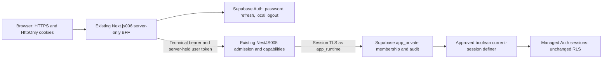

# Production Activation — Owner Plan Handoff

## Current Secret-protocol action packet — source/local only

Root accepted the one-way Secret proof-order amendment; T132–T135 are **SOURCE/LOCAL REVIEW COMPLETE**, not production acceptance. Coordinator t4v reports one scoped read-only gpt-6-luna T135 review, no actionable findings and all8 reviewed hashes matched. Reviewer ran no tests and did not independently verify OMP check results; no source fixes or reruns followed. The historical proposal/status/retention-duration text below is retained as history: the current approved policy is **manual-retention-v1**, with no scheduled age-based expiry or automatic purge and no TTL/session/token changes. Hieu/Lovora and the existing privately bound workspace/run are already approved; do not regenerate them or request another general START.

### Secure input names, destinations and formats — no values

Do not collect inputs during this documentation-only closeout. After separately approved execution, inject only the matching worker's process environment through the protected workflow environment or an explicitly approved private operator input channel. No new hidden-TTY collector was implemented; no original file/auth-store read, secret argv/chat/log, blanket environment export or automatic bearer rotation is permitted.

| Protected workflow secret name | Worker environment destination | Format and allowed use |
|---|---|---|
| `BE_ACTIVATION_BRIDGE_INPUTS` | `ACTIVATION_BRIDGE_INPUTS`, bridge configuration worker only | UTF-8 JSON object with runtime-base string fields below; canonical digest must match packet `bridgeConfigDigest` |
| `BE_ACTIVATION_APP_INPUTS` | `ACTIVATION_APP_INPUTS`, strict app configuration worker only | Runtime-base plus app string fields; digest matches `appConfigDigest`; existing private workspace/retention binding |
| `VERCEL_CONFIGURATION_TOKEN` | Same name, configuration workers only | Opaque printable token string; authenticated HTTPS header, never provider-CREATE worker input |
| `BE_ACTIVATION_ROLE_INPUTS` | `ACTIVATION_ROLE_INPUTS`, role/preflight/postflight worker only | JSON string map: migration fields plus `APP_ROLES_APPROVAL_ID`, `APP_ROLES_CONFIRM_TARGET`, `APP_ROLES_RUNTIME_DATABASE_URL`, `APP_ROLES_OPERATOR_DATABASE_URL`; digest matches `roleInputDigest` |
| `BE_ACTIVATION_MIGRATION_INPUTS` | `ACTIVATION_MIGRATION_INPUTS`, migration worker only | JSON string map: `MIGRATION_TARGET`, `MIGRATION_DATABASE_URL`, `MIGRATION_CONFIRM_PROJECT_REF`, `DATABASE_URL` and Session metadata; digest matches `migrationInputDigest` |
| `BE_ACTIVATION_BOOTSTRAP_INPUTS` | `ACTIVATION_BOOTSTRAP_INPUTS`, existing-user bootstrap worker only | JSON string map: app/Session metadata and `BROWSER_ORIGIN`, plus `APP_OPERATOR_TARGET`, `APP_OPERATOR_DATABASE_URL`, `APP_OPERATOR_AUTH_KEY`, `APP_OPERATOR_CONFIRM_WORKSPACE`, `APP_OPERATOR_APPROVAL_ID`, `APP_OPERATOR_USER_ID`, `APP_OPERATOR_PROFILE_NAME`, `APP_OPERATOR_WORKSPACE_NAME`, `APP_OPERATOR_CONFIRM_PROJECT_REF`; exact bootstrap input/identity digests |
| `VERCEL_TOKEN`, `BE_PREVIEW_ACCESS_KEY`; job-scoped `GITHUB_TOKEN` | Same names, provider authorization/confirmation and candidate acceptance workers only | Opaque provider tokens and fixed64hex technical bearer; no DB/runtime/Auth-admin envelope |

Runtime-base field names: `API_RUNTIME`, `DATABASE_URL`, `BROWSER_ORIGIN`, `PREVIEW_ACCESS_KEY`, `APP_SCHEMA_MODE`, `APP_FOUNDATION_ENABLED`, `SUPABASE_PROJECT_REF`, `SUPABASE_SESSION_HOST`, `SUPABASE_DATABASE_NAME`, `SUPABASE_DATABASE_USER`, optional `DATABASE_CA_PEM`. App additions: `APP_WORKSPACE_ID`, `APP_AUTH_URL`, `APP_AUTH_API_KEY`, `APP_EMAIL_ENABLED`, `APP_RETENTION_POLICY_ID`. Session metadata means the `SUPABASE_*` fields above and optional CA. JSON values are strings, at most16384 characters each, no NUL; the decoded envelope is bounded to65536 bytes. Encode PEM newlines as JSON string escapes. Exact URL/role/TLS/UUID/key-class validation remains authoritative; runtime Auth keys must be publishable/legacy-anon, while bootstrap Auth-admin authority stays isolated.

The configuration worker derives `APP_ACTIVATION_CONFIG_DIGEST` from the approved packet and sends approved values only in an authenticated HTTPS JSON body with Secret type and exact Production target. The durable receipt contains public identities/digests/counts only and records `valueProof=pending-candidate-runtime`. It never includes runtime values. Actual startup-computed protected configuration equality on the same immutable candidate is still required; metadata, returned IDs or the expected-digest variable alone cannot authorize promotion/roles/SQL. A lost/partial write ACK or missing receipt remains UNKNOWN; no metadata-only reconciliation or rewrite/replay.

FE-owned server-only input names remain `APP_SESSION_MODE`, `APP_ORIGIN`, `APP_API_ORIGIN`, `APP_AUTH_URL`, `APP_AUTH_API_KEY`, `APP_API_TECHNICAL_KEY`, `APP_SESSION_COOKIE_KEY`. The FE owner supplies exact source/configuration/acceptance receipts separately after strict BE acceptance. This packet does not configure FE, infer authenticated acceptance from an alias or enable broad BE delivery.

### Remaining ordered gates

Completed prerequisite: T135 scoped review, with no findings or fixes. Original reviewed manifest `.openai/reports/secret-protocol-dbx3mt02/handoff.json` remains unchanged; `.openai/reports/secret-protocol-dbx3mt02/review-closeout.json` records the current source/documentation manifest and attributed review evidence.

1. Separately authorized corrected-source publication, clean tested Linux artifact and explicit corrected activation packet binding. The retained b3 artifact is pre-fix, not relabeled or rebuilt here. Preserve existing private identities and the manual-retention-v1 decision digest.
2. Keep81d4/454 fenced: obtain the missing original sanitized execution-command/mount/container-identity provenance, then observe only the established original namespace under bounded authority. The documented temporary evidence and default Docker socket were unavailable; device/inode mismatch is not repaired or treated as corruption proof. If original provenance cannot be recovered, require an explicit evidence-loss disposition, not unlock/rebind/replay.
3. Only after those gates, bind the private inputs above and authorize actual ordered activation. Strict BE and historical-fence receipts precede separate final-origin FE acceptance. No cloud configuration/SQL/bootstrap/deployment action or production-ready claim occurred in this increment.

Actual affected checks, original failing-before regression, read-only forensic limits and preservation are in [the plan](plan.md#actual-secret-protocol-sourcelocal-evidence--ready_for_review) and [validation receipt](quickstart.md#secret-compatible-activation--affected-sourcelocal-validation). T108 remains UNPROVEN; historical T110503 remains NOT REPRODUCED / CAUSE UNPROVEN. Manual006/3000/010 and all16 historical fingerprints remain preserved. **REVIEW_COMPLETE — ACTIVATION_GATED; NO_INFLIGHT / STOP WRITES.**

## Historical planning handoff — retained, not current authority

**Status: READY_FOR_OWNER_PLAN_REVIEW — STOP WRITES after final receipt.** This is feature001's complete activation proposal, not permission to implement, publish, read private inputs/accounts, run SQL or deploy. Existing main/reviewed work is preserved; no new feature or tracker.

## What exists and what is missing

- **Accepted:** [005 BE foundation](../005-app-foundation/quickstart.md), [006 corrected local session journey](../006-login-session/quickstart.md) and its [frozen BFF contract](../006-login-session/contracts/session-bff.md), canonical OpenAPI0.4.0, ordinary versioned migration runner and existing Vercel projects.
- **Owner-reported, not queried again:** the existing Auth identity was created and password login PASSED. No app Owner exists. Cloud app tables/session function/runtime/operator roles are reported absent; no app schema was applied.
- **Missing implementation:**001 schema-changing durable orchestration/secure phase inputs, reviewed role provisioning/reconciliation, strict two-history bridge and FE nonce CSP. Current `ci-delivery.ts` is OLD/current-only with no migration runner invocation.
- **Missing release proof:** new scoped checks/review, exact publication/source tree, clean Linux artifact, compatible predecessor, actual roles/migration/bootstrap, strict BE/FE deployment and real HTTPS browser acceptance. Prior699 health PASS and reported `97000fa` publication do not include dirty006/new activation work.
- **Not included:** connected007/008/009 bodies, SMTP/email flows,010 Etsy integration, new infrastructure, Render, paid upgrades or automatic cleanup. Sample Application/Settings/Team content remains truthful and unconnected.

## Architecture and sequence

The browser never receives a technical/admin/DB/bypass key or a readable Auth token. Nest checks current session and membership on each protected request; role metadata and UI labels do not grant access.

| Stage | Required exit before proceeding |
|---|---|
| S0 Approve → implement → local proof → one later Luna review → publish → Linux build | Exact accepted005/corrected006/source/tree/contract/migration/artifact inventories; FE production assignment held |
| S1 Durable intent and read-only preflight | Exact target/TLS/OLD/predecessor/role capability, approved secure inputs and actual backup/protection boundaries |
| S2 Deploy compatible disabled-app bridge | Exact tested artifact/files/configuration, known deployment ID and actual API domain proof before any live SQL mutation |
| S3 Provision roles → migrate | Separate least privilege; durable confirmed TARGET transaction and actual ACL/definer evidence |
| S4 Bootstrap existing Auth user | Approved exact private workspace/user/names/approval; one atomic profile/workspace/active Owner/audit outcome |
| S5 Strict app BE → S6 held FE candidate → final HTTPS | Same approved BE bytes; app_runtime/email disabled. FE candidate gets source/build/configuration and bounded noncredential checks, then durable same-candidate promotion; full login/session proof runs only at final APP_ORIGIN, never a different generated hostname |
| S7 Observe and close | Safe redacted health/errors, exact evidence/limits and explicitly released test-only cleanup; no unresolved outcome |

### Why the bridge is required

**Recommended:** disabled-app readiness supports only exact OLD or full TARGET; strict app mode supports TARGET only. OLD is `243818c0ebe11bc6ea8b12b3224810c88e888b18ec30dd5bfe58394f1f209496`; TARGET is `149cb530551c0f0e2b734c1aa1086eac5615e01ebca152a8203490c8d93200c3`. The original migration remains an immutable prefix of the three-file target.699 rejects added history, so live SQL cannot precede a verified bridge unless the owner expressly elects bounded maintenance.

No arbitrary prefix/future history or baseline flip. The bridge artifact still honestly contains all three TARGET files. A two-entry partial history is rejected. OLD→TARGET applies **two files in one transaction**, then0 on repeat; this is one approved transition→zero new transitions, not a fabricated applied1 count. Historical foundation-only1→0 remains unchanged.

Unknown role/SQL/bootstrap/create/promotion outcomes fence the next phase and rerun. Persist intents before effects and known IDs before inspection; reconcile read-only before explicit continuation. After SQL commits, no699 rollback/down/reset; a bridge fallback restores only foundation health, not app availability. Provider rollback cannot undo DB/Auth or refresh old deployment variables. Full design: [A2–A5](plan.md#a2--ordered-activation-and-the-minimal-bridge).

## Grouped decisions for the owner

| Decision | Concrete proposal / boundary |
|---|---|
| Display and workspace | Profile **Hieu**, workspace **Lovora**, both reviewable display names only. Approve one workspace UUID later through the private channel; public docs use only `OWNER_AUTH_USER_ID` for the existing Auth user. No real identity/password/UUID in chat or this document. |
| Retention | Proposed `internal-launch-retention-v1`: active records for workspace lifetime; disabled identifying profile names and terminal invitations90 days; app audit365 days, retaining minimal disabled identity/membership links needed by those audit foreign keys; redacted release evidence for project lifetime. Manual review/anonymization/deletion only through a separately approved safe procedure; no automatic purge/Auth deletion or legal-compliance promise. |
| Cutover, only if not using the recommendation | Accept the bounded bridge, or expressly elect a dated/bounded maintenance window with app/API outage and recovery limits. No implicit downtime approval. |

Initial **application email delivery is disabled**; keep the already working Supabase email/password sign-in provider unchanged.007/009 SMTP is not a blocker for this confirmed password user. Lost-Owner recovery remains out-of-band identity verification + explicit approval + supported provider recovery/session revocation; retain current workspace/role and never reactivate a disabled member or replay bootstrap as repair. An unrecoverable final Owner needs a separately reviewed audited procedure, not an invented replacement.

## One owner authorization checklist

These unchecked gates are requests for later decisions/evidence, not claims that execution has happened. Detailed work is [T095–T123](tasks.md#story-8--complete-production-activation-p1-plan-only).

- [ ] Approve the grouped name/workspace/retention and recommended bridge decisions; scope the next source/local increment without authorizing cloud/publication implicitly.
- [ ] Confirm the plan's exact OLD/TARGET/source/artifact binding, current-only preservation, durable unknown-outcome stops and post-commit recovery/backup limits are acceptable.
- [ ] Grant exact BE/FE/workflow/resource leases; preserve manual006 until explicit stop/release. Obtain the actual final-domain caller/protection decision before implementation freeze/review, without automatically disabling protection or adding an unused bypass path.
- [ ] Require meaningful affected local functional/HTTP/DB/migration/native/security/browser proof, including real non-NULL local Auth timebox expiry, then one available scoped Luna review and owning-lane fixes.
- [ ] Separately authorize exact serial publication/build; hold FE production assignment before a source push and approve the clean Linux BE artifact plus exact FE source/build candidate identity.
- [ ] Separately authorize new secure role/migration/bootstrap inputs and live preflight/bridge/SQL/bootstrap/BE/FE operations in that order. Existing converted originals remain untouched; runtime receives no operator/admin/service key.
- [ ] Require real exact-deployment HTTPS Owner login/current workspace/capabilities/protected routes/refresh/confirmed local logout and old-JWT denial; synthetic Member/missing/disabled/demoted/revoked cases, public/mobile/keyboard/CSP/cross-user checks and honest hosted timebox limits.
- [ ] Accept only actual final receipts, unresolved-gate disclosure, safe health/error observation and explicit test-resource/lease return; no production destructive/load test, paid upgrade or automatic manual006 cleanup.

Configuration names and boundaries: [A7](plan.md#a7--capabilities-fe-boundary-and-names-only-configuration). BE uses app_runtime, exact Auth issuer/JWKS/workspace/retention, technical bearer and verified Session TLS. FE keeps `APP_SESSION_MODE=hosted`, `APP_ORIGIN`, `APP_API_ORIGIN`, `APP_AUTH_URL`, `APP_AUTH_API_KEY`, `APP_API_TECHNICAL_KEY`, `APP_SESSION_COOKIE_KEY` server-only; actual HTTPS cookies are `__Host-`/Secure/HttpOnly with exact origin/CSRF/return-path rules. The actual BFF caller, not an acceptance-tool bypass, must work through platform protection.

## Stable ownership and retained resources

BE OMP t4q owns future `apps/api/**` and001; workflow changes need their exact lease. FE OMP t4p alone owns `apps/web/**`; coordinator t4x controls FE/005/006 documentation leases. Release coordinator t4v owns cross-lane ordering/publication/release permissions and the one later review. Owner/brainstorm t4y receives this handoff. No new agent/reviewer starts now.

Read AGENTS → PROJECT_STATE → architecture → constitution →001 spec/plan/tasks and linked005/006 before future implementation; use the installed local Spec Kit workflows and `vercel-react-best-practices` for React/Next.js changes. No root dependency/pointer/canonical migration/contract change is implied.

Manual006 nonce `3073584d0a78c78355c75e5d0665ea4d`, FE t6h/API t6f/forwarder t6c/accounts/ports55440–55444 stay KEEP-RUNNING. Owner preview3000/default `.next`, shared services and volumes remain untouched. No resource health or private-file check was performed by this planning work.010 stays DONE/STOP WRITES;005/006/source/shared docs are only referenced, not edited.

## Coverage and actual planning checks

[Coverage table](tasks.md#activation-dependencies-and-coverage): FR-030–FR-043 and SC-019–SC-026 map to unchecked T095–T123. [Validation plan](quickstart.md#production-activation-validation-plan) separates documentation, future local and future hosted evidence; [research](research.md#complete-production-activation-decisions) records observed source, official citations and limits.

The first read-only analysis found one HIGH and three MEDIUM documentation gaps. **A01–A04 are now RESOLVED in this scoped document recheck**; original findings remain below, not rewritten as a no-findings first pass. No confirmed blocking documentation gap remains; owner decisions and later implementation/provider permissions intentionally remain open. This is not an independent code review or behavioral test.

| Finding | Original severity / evidence | Scoped repair |
|---|---|---|
| A01 | HIGH; draft T121/quickstart candidate-login order versus frozen006 exact Origin/Host contract | Candidate metadata/noncredential checks → durable promotion → full session proof at final APP_ORIGIN; no origin relaxation/rebuild |
| A02 | MEDIUM; draft CSP scope and nonexistent layout targets | Existing page targets, full-document public/protected crossings, explicit style-attribute allowance and navigation/hydration checks |
| A03 | MEDIUM;90-day profile retention versus365-day audit foreign keys | Explicit minimal identity-link retention through referenced audit lifetime; identifying-name anonymization requires approved procedure |
| A04 | MEDIUM; runtime no-service-key intent lacked assigned key-class checks | BE/FE hosted publishable/legacy-anon validation and privileged/unknown-class refusal/tests; operator key remains separate |

Actual documentation checks:

- Three command-local001/NO_PERSIST prerequisite checks succeeded; no extension hooks, template reset, branch operation or pointer write.
- 14 new FRs +8 new SCs mapped22/22;29 unchecked new tasks; all123 IDs unique/sequential, no orphan new task. All94 original task rows and the five original document prefixes are byte-identical.
- 26 new local Markdown links /16 fragments resolve; new fences balanced, no trailing-whitespace lines or actual email/identity-UUID literals.
- 214 protected public files unchanged, including005/006/010, BE/FE source, canonical/generated/migrations, root/shared files, pointer and workflow. Protected path→SHA256 map digest: `611fb299934ea5e2ce3e8be37556db14da002fdf9a0863811d1309b2130f6b95` (SHA256 of sorted compact JSON).
- Canonical0.4.0 and both OLD/TARGET migration digests match the preserved source. Existing source publication97000fa remains coordinator-reported, not rechecked with Git.

Only the five existing001 documents and this handoff were written. No runtime/test/build/install/Git/private/account/SQL/deployment/DNS action, resource probe/cleanup, new reviewer or production acceptance. Manual006 remains KEEP-RUNNING; no temporary repository script or new runtime resource was created by this planning increment.

## Subsequent source/local execution status

The preceding sections retain the original planning-only evidence. The later explicit owner START authorized T095–T111 source/local work; actual decisions, failures and checks now live in [the implementation record](plan.md#independent-be-implementation-and-actual-checks), [task status](tasks.md#current-sourcelocal-authorization) and [validation receipts](quickstart.md#verified-be-activation-increment-and-execution-boundaries).

- BE T097–T102/T105–T107/T109/T111 source/local checks are recorded. Synthetic CI31/31, affected integration28/28 and corrected private-TMPDIR release121/121 passed; original failed/timed-out attempts remain retained. Real Auth/application evidence is the separately recorded18/18 run, not the structural role smoke.
- Native02 artifact `56286e996c114bc16b297dcf7467744affb3eb4b6d0697e9f17f2244182baa58` passed actual sealed HTTP/TLS/cancellation and bridge OLD→TARGET2→0 smokes. Darwin/arm64 development output remains **NONRELEASABLE**; actual Linux/provider/hosted proof is absent.
- BE source freeze binds89 native inputs, the unchanged canonical/generated/migration hashes and additional workflow/example files. The exact receipt is linked in the plan; T096's coordinator publication allowlist/FE hold remains open.
- T108 is explicitly **UNPROVEN and unchecked**. Pinned password/global30s timeboxing yielded NULL `not_after`, valid-JWT `/me`200 before/after31.97s and refresh400/`session_expired`. Root accepted this as a supported refresh-enforcement observation, not non-NULL coverage or a demonstrated bug. No further timebox experiment/workaround is authorized; the precise coverage gap still needs owner acceptance.
- T110's historical natural300s BFF503 remains unexplained. One newly authorized diagnostic has fresh bilateral resource/source/configuration binding and BE_READY; exclusive FE_BROWSER is active under nonce `111c9db9e9a94eb3529024a10c6e90c3`, final parent `esty001-activation-wpj6tn2b`, ports55540–55544. The test-only observer and fresh synthetic configuration are separately hashed; this is not exact historical environment replay. Await actual before-assertion sanitized evidence and explicit FE_RELEASE before cleanup.
- Original cleanup failures remain distinct: application cleanup committed, four individual Auth deletions unconfirmed after the synthetic admin JWT expired, then that disposable fixture retired. The timebox and standalone55532 fixtures were separately retired with their own receipts.

No joint READY_FOR_REVIEW, new reviewer, publication, Linux release, provider/account/SQL/deployment/DNS/billing approval or product completion is claimed. Manual006/owner3000/shared services and volumes remain protected. Only the coordinator may resolve later gates and start the separately authorized review.

The newly authorized T110 diagnostic is now complete: exactly one case PASS1/1,311.83s, with pre-assertion BFF401/`unauthenticated` correlated to an actually expired300s JWT and BE401. The historical503 did not reproduce; its cause remains unproven and no production fix/repeat is justified. After explicit FE_RELEASE, fresh application cleanup and all four individual Auth deletions were confirmed; forwarder/fixture retirement exited0, no owned containers/networks remain and55540–55544 are free. The prior run's unconfirmed deletions remain distinct. See [the final diagnostic/retirement record](plan.md#single-natural-expiry-diagnostic-result-and-guarded-retirement).

**Remaining decisions, not more automatic work:** owner/coordinator disposition of T108's unsupported non-NULL coverage and T110's retained unexplained historical failure, T096 final publication allowlist/FE hold, then separately authorized review/publication/Linux/provider/hosted gates. No joint review readiness or hosted completion is claimed. Source and runtime work stop; retained evidence is not a release artifact approval.

The owner subsequently authorized the single coordinator-run T112 review. T108 remains explicitly UNPROVEN/unchecked: supported password/global-timebox refresh enforcement was observed, but no provider-issued non-NULL `not_after` branch proof exists; review may assess relevance, not turn authorization into a waiver/pass. Current-scope T110 scenarios are accepted on the frozen-current evidence while historical503 remains NOT REPRODUCED / CAUSE UNPROVEN. Exact BE and ten-path FE manifests, including changed helpers/tests/configuration and fresh source/docs pauses, define the review scope. No source/docs writer runs during review; no repeated check, publication, deployment or hosted approval is implied.
